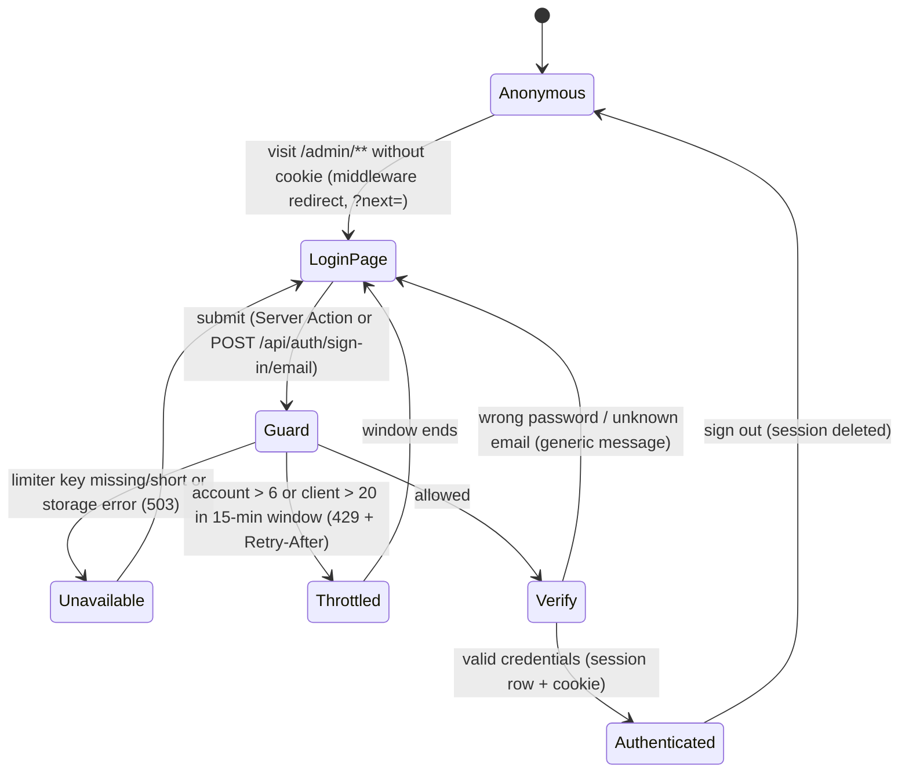
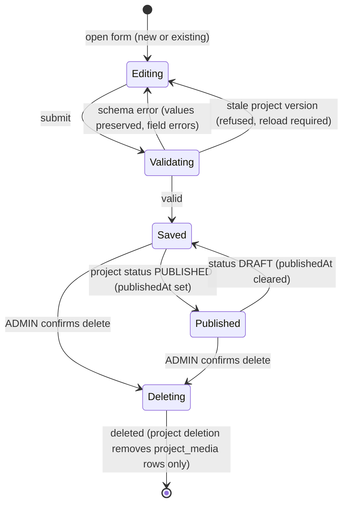
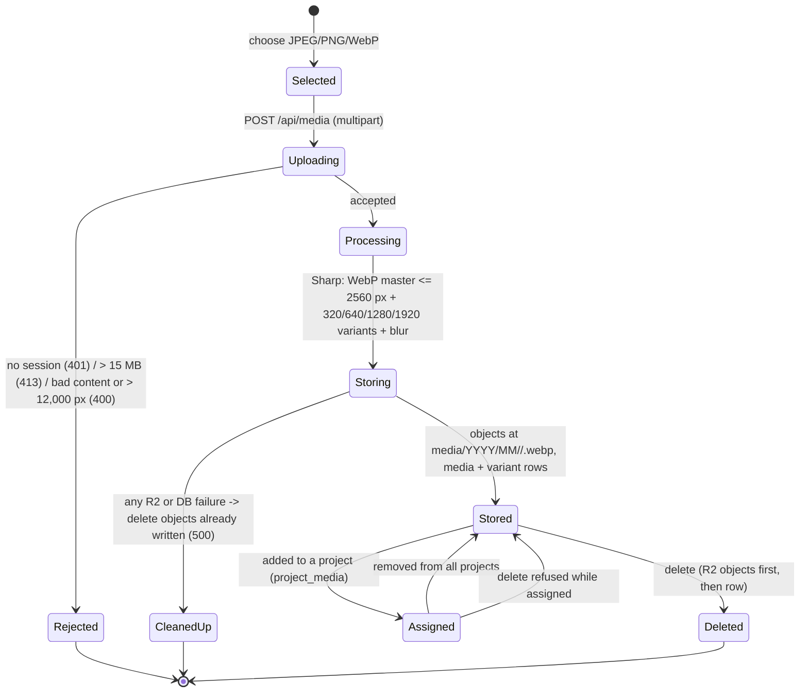
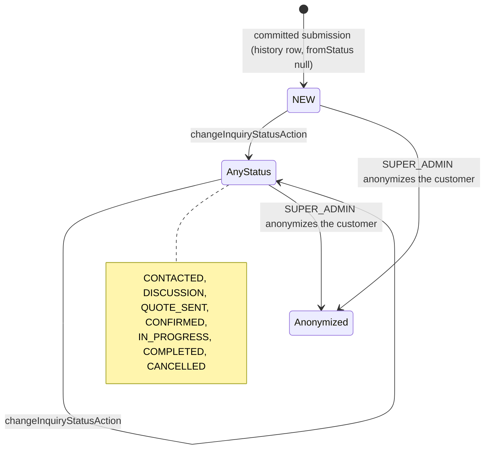
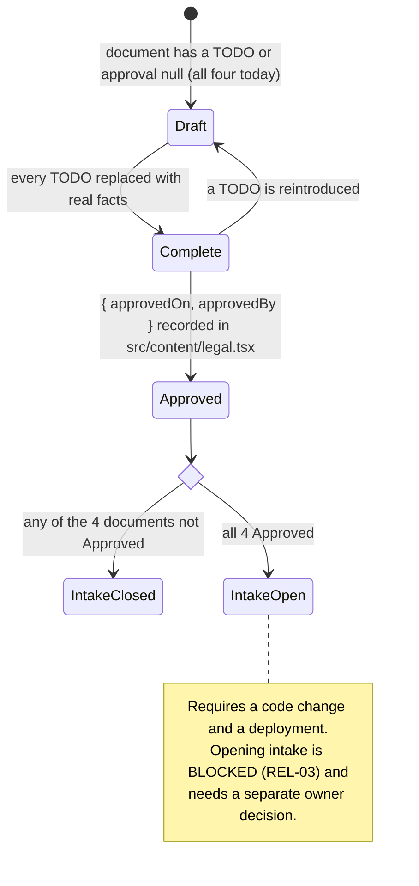

# 02 — Application Flow and State Machines

| Field | Value |
| --- | --- |
| Document | `docs/02_AppFlow.md` |
| Version | 1.6.0 (MH-15: categories and testimonials removed, simplified admin navigation and dashboard, `/work` static; LOCAL ONLY, not deployed; MH-14: upload and thumbnails in the project media picker; MH-13: no project category; MH-11: simplified project editor; MH-10: project video by pasted link) |
| Last reviewed | 2026-11-11 |
| Reviewed against | commit `379e53b` (branch `fix/media-delete-admin-only`) |
| Document status | Locally maintained draft. This status does not imply owner approval, push, or deployment. |

## Purpose

This document inventories every route the application serves and describes how
each screen behaves: what it reads, what its controls do, and what happens in
its empty, error, unauthorized, and success states. It then defines the state
machines behind authentication, content, media, inquiries, email, and the legal
gate. Behaviour not found in the code is listed as a gap, never described as if
it existed.

## Related documents

- Requirements: [01_PRD.md](01_PRD.md) (IDs `FR-*`)
- Visual states of the controls: [03_UI_Spec.md](03_UI_Spec.md)
- Endpoint contracts: [04_TRD.md](04_TRD.md#5-api-and-server-actions)
- Entities and lifecycles: [05_Schema.md](05_Schema.md)
- Tasks: [06_Plan.md](06_Plan.md)

## Source references

`src/app/` (route tree), `src/middleware.ts`, `src/server/auth/session.ts`,
`src/app/(admin)/admin/*-actions.ts`, `src/app/(public)/contact/actions.ts`,
`src/server/inquiry/submit-inquiry.ts`, `src/server/email/service.ts`,
`src/lib/email/delivery-claims.ts`, `src/content/legal.tsx`.

## Shared behaviour

These apply to every screen of their route group and are not repeated below.

| ID | Behaviour | Evidence |
| --- | --- | --- |
| FLOW-G-01 | **Loading:** no route defines `loading.tsx`. Pages are server-rendered. Pending UI exists inside forms (`useActionState` `pending`) and on admin navigation links, which show a pulsing dot and announce "Loading…" while a navigation is pending. Public navigation has no pending indicator. | `find src/app -name loading.tsx` returns nothing; `admin-nav-link.tsx` |
| FLOW-G-02 | **Public errors:** an unexpected render error shows `src/app/(public)/error.tsx`; unknown public paths show `src/app/(public)/not-found.tsx`; a root failure shows `src/app/global-error.tsx`. | files listed |
| FLOW-G-03 | **Admin access:** `src/middleware.ts` redirects `/admin/**` (except `/admin/login`) to `/admin/login?next=<path>` when no session cookie is present, and marks every admin response `Cache-Control: private, no-store`. The cookie is not verified there; each page then calls `requireUser`/`requireAdmin`, which validates the session against PostgreSQL. | `src/middleware.ts`, `src/server/auth/session.ts` |
| FLOW-G-04 | **Admin unauthorized:** a signed-in user without the required role gets the admin `forbidden.tsx` page (HTTP 403) on pages, `Forbidden` (403) on export routes, and an `AuthorizationError` from Server Actions. | `src/app/(admin)/admin/forbidden.tsx`, export `route.ts` files |
| FLOW-G-05 | **Admin errors:** expected failures (validation, in-use references, stale saves) return form state shown in a `Notice`; unexpected failures render `src/app/(admin)/admin/error.tsx`. | `src/lib/admin/form-state.ts`, `src/components/admin/admin-error-view.tsx` |
| FLOW-G-06 | **Admin not found:** unknown admin paths are caught by `[...missing]`, which requires a session before answering 404, so the route tree is not exposed to anonymous visitors. | `src/app/(admin)/admin/[...missing]/page.tsx` |
| FLOW-G-07 | **Public cache:** public pages revalidate at most hourly and on demand when an admin mutation revalidates the relevant cache tag. | `src/server/public/cache-tags.ts`, `src/server/public/revalidate.ts` |

## 1. Route inventory

Release state uses the vocabulary of [01_PRD.md](01_PRD.md#status-and-release-state-vocabulary).

### 1.1 Public and system routes

| Route | Kind | Rendering | Requirement | Release |
| --- | --- | --- | --- | --- |
| `/` | Page | ISR 3600 s | FR-PUB-01 | PUBLISHED |
| `/work` | Page | ISR 3600 s (MH-15, LOCAL ONLY; the published build is dynamic and reads `searchParams.category`) | FR-PUB-02 | PUBLISHED |
| `/work/[slug]` | Page | ISR 3600 s, `generateStaticParams` | FR-PUB-03 | PUBLISHED |
| `/services` | Page | ISR 3600 s | FR-PUB-06 | PUBLISHED |
| `/about` | Page | ISR 3600 s | FR-PUB-07 | PUBLISHED |
| `/contact` | Page + Server Action `submitInquiry` | ISR 3600 s | FR-PUB-08, FR-INQ-01, FR-INQ-05 | PUBLISHED (gate closed) |
| `/impressum`, `/legal-notice`, `/datenschutz`, `/privacy` | Page | Static; 404 while draft | FR-PUB-09 | PUBLISHED (all 404) |
| `/sitemap.xml` | Metadata route | Revalidating | FR-PUB-10 | PUBLISHED |
| `/robots.txt` | Metadata route | Revalidating | FR-PUB-10 | PUBLISHED |
| `/opengraph-image` | Metadata route | Generated image | FR-PUB-10 | PUBLISHED |
| `/icon.svg`, `/apple-icon.png`, `/favicon.ico` | Static assets | Static | — | PUBLISHED |
| `/api/auth/[...all]` | Route Handler (Better Auth) | Dynamic | FR-ADM-01, FR-ADM-02 | PUBLISHED; login guard LOCAL ONLY |
| `/api/media` | Route Handler `POST` | Dynamic, Node.js runtime | FR-MED-01 | PUBLISHED |

### 1.2 Admin routes

All are `force-dynamic` and require a valid session.

| Route | Minimum role | Requirement |
| --- | --- | --- |
| `/admin/login` | none | FR-ADM-01 |
| `/admin` | EDITOR | FR-ADM-05 |
| `/admin/projects`, `/admin/projects/new`, `/admin/projects/[id]` | EDITOR (delete: ADMIN) | FR-CMS-01 |
| `/admin/services` | EDITOR (delete: ADMIN) | FR-CMS-03 |
| `/admin/pages` | EDITOR | FR-CMS-05 |
| `/admin/settings` | ADMIN | FR-CMS-06 |
| `/admin/media` | EDITOR (delete: ADMIN, fixed locally under DEF-01; published build: EDITOR) | FR-MED-01, FR-MED-02 |
| `/admin/inquiries`, `/admin/inquiries/[id]` | EDITOR | FR-CRM-01, FR-EML-01 |
| `/admin/inquiries/export` | ADMIN | FR-CRM-03 |
| `/admin/customers`, `/admin/customers/[id]` | EDITOR (anonymize: SUPER_ADMIN) | FR-CRM-02, FR-CRM-04 |
| `/admin/customers/[id]/export` | SUPER_ADMIN | FR-CRM-03 |
| `/admin/[...missing]` | EDITOR, then 404 | FLOW-G-06 |

`/admin/categories` and `/admin/testimonials` were removed in MH-15 (FR-CMS-02,
FR-CMS-04; LOCAL ONLY, not deployed). Both paths now fall to
`/admin/[...missing]` and answer with the admin "Page not found" 404.

The admin navigation (`src/components/admin/admin-links.ts`,
`admin-shell.tsx`; MH-15) has six primary links in this order: Dashboard,
Projects, Media, Inquiries, Customers, Settings. Settings is shown only to
ADMIN and above. Below them, inside the same `<nav aria-label="Admin">`, a
small muted label "Website content" introduces a secondary group
(`ADMIN_CONTENT_LINKS`): Services (`/admin/services`) and Pages
(`/admin/pages`), rendered smaller (12px, muted). Both pages work as before
and stay open to every signed-in role. On mobile the secondary group sits
below the six links in the same Menu disclosure (two-column grid, the label
spanning both columns). The other admin pages are reached from links within
admin pages.

## 2. Screens

Each block lists only what differs from the shared behaviour above. "Action"
names are Server Actions in `src/app/(admin)/admin/*-actions.ts` unless stated.

### 2.1 Public screens

#### SCR-PUB-01 — Homepage `/`

- **Purpose:** first impression and routing into the portfolio.
- **Entry:** direct visit, search, social links, the header logo.
- **Navigation:** header (Work, Services, About, Contact), footer, section CTAs.
- **Data:** `getHomepageContent()`: settings (showreel), featured projects,
  services, `Page` content. No testimonials and no category label in the hero
  (removed in MH-15).
- **Actions:** links to `/work`, `/work/[slug]`, `/services`, `/contact`; the
  showreel play button activates the embed (no request before the click).
- **Empty:** sections with no content are omitted; visitors never see
  administrative wording. `VisualPlaceholder` fills only image frames that have
  no image.
- **Error:** FLOW-G-02. **Unauthorized:** not applicable.
- **Side effects:** none server-side.

#### SCR-PUB-02 — Work `/work`

- **Data:** `getPublishedProjects()`: every project whose status is
  `PUBLISHED`.
- **Actions:** project cards link to `/work/[slug]`. There is no category
  filter and no category label on the cards (removed in MH-15).
- **Validation:** the page takes no `searchParams`; an old
  `/work?category=...` link shows the whole portfolio.
- **Empty:** "New work is being prepared for this portfolio. Please check back
  soon." (`emptyStates.work` in `src/content/site.ts`).

#### SCR-PUB-03 — Project `/work/[slug]`

- **Data:** `getPublishedProjectBySlug(slug)`.
- **Actions:** gallery viewing; the video play button (over the project cover)
  builds the embed URL from provider and ID: YouTube, Vimeo, or Google Drive.
- **Error / not found:** a draft project or an unknown slug calls `notFound()`
  and returns the same 404. A project is shown exactly when its status is
  `PUBLISHED` (MH-15); the page has no category label and no "Category" fact.

#### SCR-PUB-04 — Services `/services`

- **Data:** `getPublicPage("services")`, `getActiveServices()`.
- **Actions:** links to `/contact`.
- **Empty:** no active services means no services list. There is no
  testimonial block (removed in MH-15).

#### SCR-PUB-05 — About `/about`

- **Data:** `getPublicPage("about")`, `getPublicSiteSettings()`.
- **Empty:** sections without content are omitted. There is no testimonial
  block (removed in MH-15).

#### SCR-PUB-06 — Contact `/contact`

- **Data:** `getPublicPage("contact")`, `getPublicSiteSettings()`,
  `getActiveSocialLinks()`, `getActiveServices()`, `isInquiryIntakeOpen()`.
- **Closed state (current):** renders "Online inquiries will open soon." in
  place of the form. No Turnstile script loads.
- **Open state (implemented, never live):** renders `InquiryForm` with the
  Turnstile widget. Submit calls `submitInquiry`.
  - **Validation:** `inquirySchema` field errors are shown beside fields; focus
    and scroll move to feedback (`src/lib/public/inquiry-form.ts`).
  - **Pending:** the submit button is disabled while pending and until a
    submission token exists.
  - **Error:** fixed messages: "Please check the highlighted fields.",
    "Verification failed. Please try again.", "We could not receive your inquiry.
    Please try again later." (rate limited or limiter unconfigured), "We could not
    receive your inquiry. Please try again." (unexpected).
  - **Recovery:** the form keeps the visitor's text after a failure and can copy
    the message ("Your message has been copied.").
  - **Success:** "Thank you. Your inquiry has been received." (identical for a
    replay).
- **Side effects:** see SM-05.

#### SCR-PUB-07 — Legal pages

- **Current state:** every page answers 404 and is absent from the footer and
  the sitemap, because no document has an approval (SM-08).

### 2.2 Admin screens

#### SCR-ADM-01 — Login `/admin/login`

- **Entry:** middleware redirect with `?next=`, or direct visit.
- **Data:** none. A signed-in visitor is redirected to `/admin` (or to a safe `next`).
- **Actions:** `signInAction` (Server Action, `src/app/(admin)/admin/login/actions.ts`).
- **Validation:** `adminLoginSchema` (email lower-cased; password present).
  Invalid fields are announced with `aria-invalid` and `aria-describedby`.
- **Pending:** the submit button is disabled; a polite live region reports status.
- **Error:** "Unable to sign in with those credentials." for any credential
  failure; "Sign-in is temporarily unavailable. Please try again later." when the
  login guard refuses (rate limited, limiter unconfigured, or storage failure;
  LOCAL ONLY).
- **Success:** redirect to the validated `next` path or `/admin`.
- **Side effects:** session row created; audit `admin.signed_in` or
  `admin.sign_in_failed`, written by `signInAction` only, so sign-ins through
  the HTTP route `/api/auth/sign-in/email` leave no such row; rate-limit
  counters incremented on both paths (LOCAL ONLY).

#### SCR-ADM-02 — Dashboard `/admin`

- **Data (MH-15):** six counters, in this order: Projects, Published, Drafts,
  Media, New inquiries, Open inquiries.
- **Actions:** three quick actions: "New project" (`/admin/projects/new`),
  "Upload media" (`/admin/media`), "View inquiries" (`/admin/inquiries`);
  Sign out (`signOutAction`).
- **Side effects of sign-out:** session revoked; audit `admin.signed_out`.

#### SCR-ADM-03 — Projects list, new, edit

- **Data:** projects with status (no category name, MH-15); project with its media
  (`ProjectMediaPicker`), plus the 100 newest library images with their
  thumbnail URLs.
- **Project media (MH-14):** the picker uploads images in place through
  `POST /api/media` (several at once; on file selection, not on Save), adds
  images from the library, shows thumbnails, and offers Make cover, Up, Down,
  and Remove. An upload is stored in the library at once and is attached to
  the project only when the project is saved. Remove detaches; it never
  deletes the image.
- **Actions:** `saveProjectAction` (create and update, including status, media
  roles, and order); `deleteAction` (ADMIN, confirm dialog).
- **Validation:** `src/lib/validation/cms.ts`; slug uniqueness; a project
  version check refuses a save made against stale data.
- **Form layout (MH-11, MH-13, MH-15):** visible: title (the only required field),
  short description (optional), video link, media (first image = cover), a
  Publish checkbox (`status=PUBLISHED`, absent = `DRAFT`). A closed `
`
  titled "More options (optional)" (MH-15; formerly "Advanced details")
  holds slug, description, client, location, date, order, featured, and SEO;
  every field is still submitted.
  There is no category control: a new project is saved without one, and the
  save never writes `categoryId`.
  An empty slug on a new project is generated from the title
  (`projectFormValues`); an existing slug is never regenerated. A rejected
  field inside the closed section opens it before focus.
- **Project film (MH-10):** one optional YouTube, Vimeo, or Google Drive link
  (`videoUrl`). The server parses the link (`parseEmbeddableVideoUrl`)
  and stores only provider and ID; an unsupported link is a field error on
  `videoUrl`; an empty link removes the film. No title input (MH-11): a saved
  `videoTitle` is kept while the link is unchanged; otherwise the public player
  uses the project title. Visibility follows the project's status. Preview: the
  public click-to-load player.
- **Empty:** "No projects yet."
- **Success:** a saved notice; public cache tags revalidated.
- **Side effects:** audit `cms.created`, `cms.updated`, `cms.deleted`,
  `project.published`, `project.unpublished`.

#### SCR-ADM-04 — Services `/admin/services`

The Categories and Testimonials screens were removed in MH-15 (LOCAL ONLY,
not deployed); this block now covers Services only.

- **Actions:** `saveServiceAction`; `deleteAction` (ADMIN). The delete control
  is shown only to ADMIN and above.
- **Empty:** the create form is shown.

#### SCR-ADM-05 — Pages `/admin/pages`

- **Data:** the three keyed pages `about`, `contact`, `services`.
- **Actions:** `savePageAction`.

#### SCR-ADM-06 — Settings `/admin/settings`

- **Role:** ADMIN; an EDITOR receives 403 (`forbidden()`).
- **Actions:** `saveSettingsAction`, `saveSocialAction`, `deleteAction` for
  social links.
- **Side effects:** public layout, metadata, and contact details revalidated.

#### SCR-ADM-07 — Media `/admin/media`

- **Actions:** upload (`UploadForm` → `POST /api/media`), `updateMediaMetadataAction`,
  `deleteMediaAction`.
- **Upload validation:** client accept list `image/jpeg,image/png,image/webp`;
  the server rejects over 15 MB (413), wrong content, or over 12,000 px (400).
- **Pending:** controls disabled while uploading.
- **Error:** server message, or "The image could not be uploaded. Check your
  connection and try again." on network failure; deleting an image used by a
  project shows "This image is assigned to a project. Remove it from the project
  before deleting it." beside it.
- **Empty:** "No media uploaded yet."
- **Success:** "Image uploaded successfully."; the list refreshes.
- **Unauthorized (delete):** the Delete control is rendered only for ADMIN and
  SUPER_ADMIN (`canDelete = isAdministrative(user.role)`). An EDITOR who calls
  `deleteMediaAction` directly gets `AuthorizationError`, which shows the admin
  error page, and nothing is deleted. LOCAL ONLY (DEF-01 fix, branch
  `fix/media-delete-admin-only`, commit `379e53b`, not pushed, merged, or
  deployed); the published build still offers
  and accepts EDITOR deletion.
- **Known race:** a project assignment made between the reference check and the
  row deletion can leave a database reference to deleted R2 objects (DEF-04).

#### SCR-ADM-08 — Inquiries list `/admin/inquiries`

- **Data:** 25 per page, ordered newest first, filtered by `status` and `q`.
- **Actions:** search and filter (GET form), pagination, open detail;
  "Export CSV" link shown only to ADMIN and above. It is a plain
  `<a download>`, never `next/link`: a prefetched link would run the export.
- **Empty:** "No inquiries found."

#### SCR-ADM-09 — Inquiry detail `/admin/inquiries/[id]`

- **Data:** inquiry snapshot, current customer, status history, email deliveries.
- **Actions:** `changeInquiryStatusAction`; `retryInquiryEmailAction`;
  `recoverMissingInquiryEmailsAction` (MAIN, UNPUBLISHED).
- **States:** `saved`, `info`, and `error` notices via query string; a delivery
  with possible-duplicate risk requires explicit confirmation.
- **Not found:** an unknown ID calls `notFound()`.

#### SCR-ADM-10 — Customers `/admin/customers`, `/admin/customers/[id]`

- **Data:** 25 per page with search; detail with notes and inquiries.
- **Actions:** `updateCustomerAction`, `addCustomerNoteAction`;
  `anonymizeCustomerAction` and the export link (a plain `<a download>`, for
  the same reason) only for SUPER_ADMIN.
- **Empty:** "No customers found.", "No notes yet."
- **Anonymized state:** the record shows it was anonymized; repeating is a no-op.

#### SCR-ADM-11 — Exports

- `/admin/inquiries/export` (ADMIN): CSV of all inquiries; audit `crm.exported`.
- `/admin/customers/[id]/export` (SUPER_ADMIN): one customer's data; audit
  `privacy.customer_exported`.
- Unauthorized: plain-text `Forbidden` with 403.

## 3. Screen-action matrix

| Action | Invoked from | Mechanism | Minimum role | Writes | Audit action |
| --- | --- | --- | --- | --- | --- |
| `submitInquiry` | `/contact` | Server Action | public, gate must be open | customer, inquiry, rate buckets, email deliveries | `inquiry.created`, `email.*` |
| `signInAction` | `/admin/login` | Server Action | public | session, rate buckets (LOCAL ONLY) | `admin.signed_in`, `admin.sign_in_failed`, `admin.sign_in_throttled` |
| Better Auth `POST /api/auth/sign-in/email` | HTTP clients | Route Handler | public | as above | as above |
| `signOutAction` | admin shell | Server Action | session | session deleted | `admin.signed_out` |
| `saveProjectAction` | projects new/edit | Server Action | EDITOR | project, project_media | `cms.*`, `project.*` |
| `saveServiceAction`, `savePageAction` (`saveCategoryAction` and `saveTestimonialAction` removed in MH-15) | list pages | Server Action | EDITOR | the entity | `cms.*` |
| `saveSettingsAction`, `saveSocialAction` | settings | Server Action | ADMIN | site_setting, social_link | `cms.*` |
| `deleteAction` (kinds `project`, `service`, `socialLink` only since MH-15) | list pages, settings | Server Action | ADMIN | deletes the entity | `cms.deleted` |
| upload | media | `POST /api/media` | EDITOR | media, media_variant, R2 objects | `media.uploaded` |
| `updateMediaMetadataAction` | media | Server Action | EDITOR | media | `media.updated` |
| `deleteMediaAction` | media | Server Action | ADMIN (LOCAL ONLY, DEF-01; published build: EDITOR) | R2 objects, media | `media.deleted` |
| `changeInquiryStatusAction` | inquiry detail | Server Action | EDITOR | inquiry, inquiry_status_history | `inquiry.status_changed` |
| `retryInquiryEmailAction` | inquiry detail | Server Action | EDITOR | email_delivery | `email.delivery_retried`, `email.*` |
| `recoverMissingInquiryEmailsAction` | inquiry detail | Server Action | EDITOR | email_delivery | `email.delivery_recovery_requested`, `email.*` |
| `updateCustomerAction` | customer detail | Server Action | EDITOR | customer | `customer.updated` |
| `addCustomerNoteAction` | customer detail | Server Action | EDITOR | customer_note | `customer_note.created` |
| `anonymizeCustomerAction` | customer detail | Server Action | SUPER_ADMIN | customer, inquiries | `privacy.customer_anonymized` |
| inquiry CSV export | inquiries list | `GET` Route Handler | ADMIN | none | `crm.exported` |
| customer export | customer detail | `GET` Route Handler | SUPER_ADMIN | none | `privacy.customer_exported` |

## 4. State machines

### SM-01 — Admin authentication

The Guard step exists only in the LOCAL ONLY commits (`10f09b4`, `ce81964`).
In the published build, sign-in goes straight to Verify, and only Better Auth's
per-process limiter (3 per 10 s per address, HTTP route only) applies (ADR 0011).

### SM-02 — Session expiration

```mermaid
stateDiagram-v2
    [*] --> Active: sign-in, expiresAt = now + 8 h
    Active --> Active: request within session; expiry slides at most once per hour (updateAge 1 h)
    Active --> Expired: now > expiresAt
    Active --> Revoked: sign-out (row deleted)
    Expired --> LoginRedirect: next admin request (page validates against PostgreSQL)
    Revoked --> LoginRedirect
    LoginRedirect --> [*]
```

There is no cookie cache, so expiry and revocation take effect on the next request.

### SM-03 — CMS create, edit, delete

Every successful save or delete writes an audit row and revalidates the
affected public cache tags. The earlier "refused, still referenced (FK
RESTRICT)" outcome of a delete applied to categories only and went with them
in MH-15; `deleteAction` now handles projects, services, and social links.

### SM-04 — Media upload and processing

### SM-05 — Inquiry submission

```mermaid
stateDiagram-v2
    [*] --> Gate
    state Gate <<choice>>
    Gate --> Closed: isInquiryIntakeOpen() false (current state)
    Gate --> Validate: open
    state Validate <<choice>>
    Validate --> Rejected: schema error or honeypot filled
    Validate --> Replay: valid
    state Replay <<choice>>
    Replay --> Success: token already committed (no new writes; missing email claims recovered)
    Replay --> Limit: new token
    state Limit <<choice>>
    Limit --> Refused: over 5/10 min or 20/24 h, or limiter unconfigured
    Limit --> Turnstile: allowed
    state Turnstile <<choice>>
    Turnstile --> Failed: invalid / misconfigured / unavailable
    Turnstile --> Persist: verified
    Persist --> Success: customer upsert + inquiry committed, then email (SM-07)
    Persist --> Error: transaction failed (generic message)
    Closed --> [*]
    Rejected --> [*]
    Refused --> [*]
    Failed --> [*]
    Success --> [*]
    Error --> [*]
```

Every refusal logs one fixed category through `logInquiryFailure` and never
logs the submitted values.

### SM-06 — Inquiry management

**Gap (OD-05):** no transition is enforced. Any of the 8 statuses may follow any
other (`statusSchema` accepts the full enum). Each change appends an
`inquiry_status_history` row with the acting user.

### SM-07 — Email delivery and recovery

States are `EmailDeliveryStatus` values, one row per inquiry and type.

```mermaid
stateDiagram-v2
    [*] --> Missing: inquiry committed, no row yet
    Missing --> PROCESSING: claim (INSERT ... ON CONFLICT DO NOTHING; not if anonymized)
    PROCESSING --> ACCEPTED: provider accepted
    PROCESSING --> FAILED: provider or application error (lastErrorCode)
    PROCESSING --> SKIPPED: Resend not configured
    FAILED --> PROCESSING: retry (no duplicate risk)
    SKIPPED --> PROCESSING: retry (no duplicate risk)
    FAILED --> Confirm: retry with possible/accepted duplicate risk
    SKIPPED --> Confirm: retry with possible/accepted duplicate risk
    PROCESSING --> Confirm: stuck > 5 minutes
    Confirm --> PROCESSING: administrator confirms (stale claim taken over)
    Missing --> PROCESSING: "recover missing emails" (MAIN, UNPUBLISHED)
    ACCEPTED --> [*]
```

- Claims are conditional `UPDATE`s, so two retries cannot both send.
- An anonymized inquiry can never be claimed, so erasure always wins.
- `ACCEPTED` means the provider accepted the message. Inbox delivery is unknown
  because there is no webhook.

### SM-08 — Legal approval and inquiry activation gate

While a document is Draft, its route answers 404 and is excluded from the
footer and the sitemap. `npm run deploy:verify` fails while any draft remains.

## 5. Edge cases and their handling

| ID | Edge case | Handling | Evidence |
| --- | --- | --- | --- |
| EDGE-01 | Inquiry submitted twice (double click, network retry) | Same `submissionToken`: a replay answers success with no new inquiry. | `submit-inquiry.ts`, ADR 0006 |
| EDGE-02 | Same email from two concurrent submissions | Serializable transaction, upsert on `normalizedEmail`, bounded retry on `P2034`. | `src/server/crm/service.ts` |
| EDGE-03 | Server Action called directly while intake is closed | The action itself refuses before any work. | `submit-inquiry.ts:55` |
| EDGE-04 | Concurrent sign-in attempts on one account | One atomic upsert per bucket; exactly the limit is admitted. (LOCAL ONLY) | `rate-limit-buckets.ts`, `login-rate-limit.test.ts` |
| EDGE-05 | Client address header spoofed | Only Netlify's `x-nf-client-connection-ip` is trusted; anything malformed shares one "unknown" bucket. | `src/server/security/client-ip.ts` |
| EDGE-06 | Two admins edit one project | A version check refuses the stale save. | `src/lib/cms/project-version.ts` |
| EDGE-07 | Deleting media used by a project | Refused with an in-place message; FK `RESTRICT` backs it up. | `src/server/media/service.ts` |
| EDGE-08 | Upload fails midway | Objects already written are deleted. | `uploadMedia` in `src/server/media/service.ts` |
| EDGE-09 | Email provider down | Inquiry is still stored; delivery `FAILED`; retry later. | ADR 0007 |
| EDGE-10 | Admin opens a link to an unknown admin path | Session required first, then 404. | `[...missing]/page.tsx` |
| EDGE-11 | `next` points off-site | Only safe internal `/admin` paths are honoured. | `isSafeInternalPath`, `e5a214a` |
| EDGE-12 | Public visitor guesses a draft project slug | 404. | `getPublishedProjectBySlug` |

## 6. Implementation gaps

| ID | Gap | Related |
| --- | --- | --- |
| GAP-01 | No route-level loading UI (`loading.tsx`). For the **public** group this is deliberate: a streaming boundary commits HTTP 200 before `notFound()` runs and would turn draft URLs into soft 404s (`README.md`, "Caching"). The admin group has no such constraint recorded; whether it should get loading UI is undecided. | FLOW-G-01 |
| GAP-02 | Inquiry status transitions are unrestricted. | SM-06, OD-05 |
| GAP-03 | EDITORs could delete media. Closed locally (DEF-01 fix, not deployed); OD-01 resolved: ADMIN and SUPER_ADMIN only. | DEF-01, OD-01 |
| GAP-08 | Media deletion is check-then-delete across R2 and PostgreSQL with no lock, so a concurrent project assignment can leave a reference to deleted objects. | DEF-04 |
| GAP-04 | No password reset or MFA flow. | OD-03 |
| GAP-05 | No automated retention or expiry of inquiry data. | OD-07 |
| GAP-06 | No toast or modal system; delete confirmation uses `window.confirm`. | 03_UI_Spec |
| GAP-07 | The open-intake flow of SCR-PUB-06 has never run in production, and its database-backed integration test is postponed. | REL-02, REL-03 |

## Open decisions

OD-02, OD-03, OD-05, and OD-07 affect these flows (OD-01 is resolved). See the
[decision register](06_Plan.md#decision-register).

## Known limitations

- Screen descriptions come from source inspection and automated tests. They have
  not been re-verified in a browser for this document.
- Behaviour of the open inquiry flow is verified by unit and render tests only.
