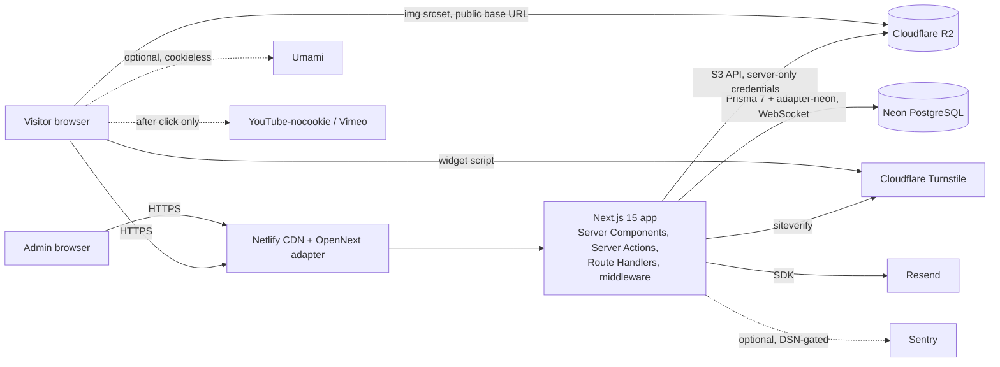
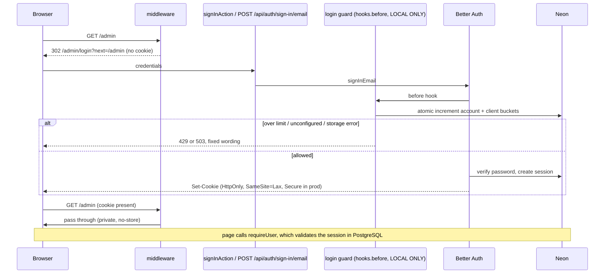
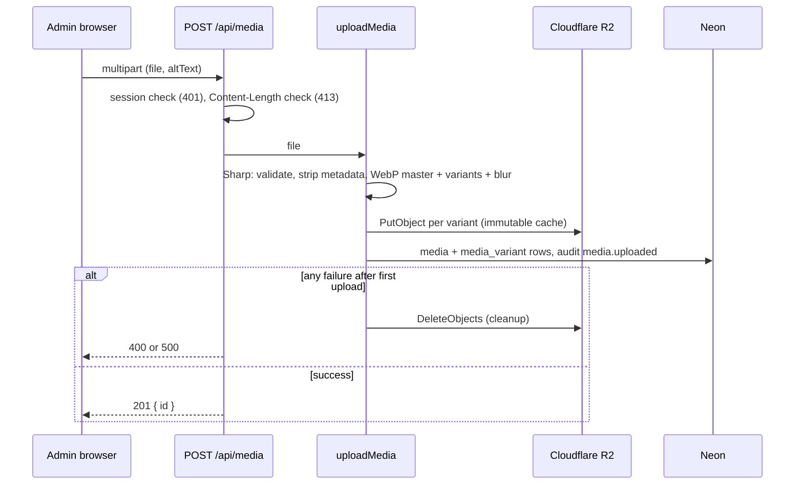
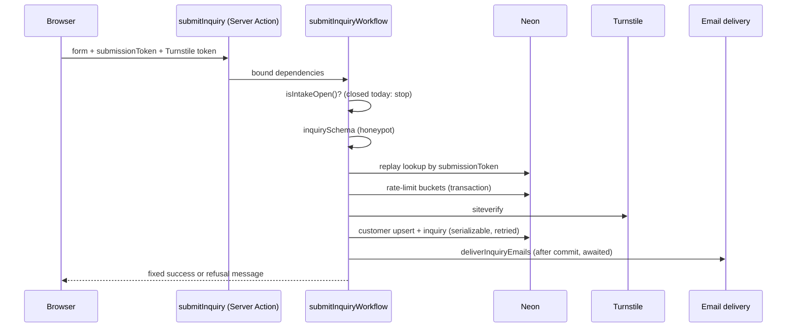
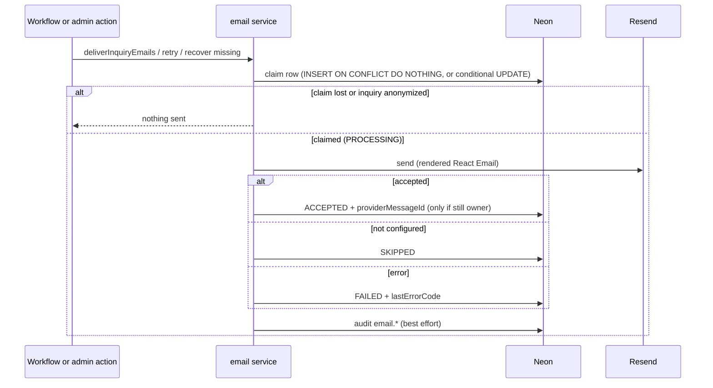

# 04 — Technical Requirements Document

| Field | Value |
| --- | --- |
| Document | `docs/04_TRD.md` |
| Version | 1.4.0 (P3-11C video routes, `MUX_*` variables, and the unapplied video migration recorded) |
| Last reviewed | 2026-11-06 |
| Reviewed against | commit `b1a579d` and the RR-03 bundle-test changes made on top of it (branch `fix/sentry-production-initialization`) |
| Document status | Locally maintained draft. This status does not imply owner approval, push, or deployment. |

## Purpose

This document defines the technical baseline that any change must respect: the
locked technology versions, system architecture, module boundaries, every
endpoint and Server Action, third-party services, security controls, and
deployment. It closes with the architectural decisions in force and, separately,
the open decisions, confirmed defects, and technical debt.

## Related documents

- Requirements served: [01_PRD.md](01_PRD.md)
- User-visible flows of each endpoint: [02_AppFlow.md](02_AppFlow.md)
- Data and authorization model: [05_Schema.md](05_Schema.md)
- Work tracking: [06_Plan.md](06_Plan.md)
- Earlier documentation: [ARCHITECTURE.md](ARCHITECTURE.md), [DEVELOPMENT.md](DEVELOPMENT.md), [DECISIONS/](DECISIONS/)

## Source references

`package.json`, `package-lock.json` (lockfile v3), `.node-version`,
`next.config.ts`, `tsconfig.json`, `netlify.toml`, `eslint.config.mjs`,
`postcss.config.mjs`, `prisma.config.ts`, `neon.ts`, `src/middleware.ts`,
`src/instrumentation.ts`, `src/instrumentation-client.ts`,
`src/sentry.server.config.ts`, `src/server/**`, `src/lib/**`,
`src/app/**/route.ts`, `src/app/**/*actions.ts`, `scripts/**`.

---

## 1. Locked technology baseline

**TRD-STACK-01.** Versions below are the exact installed versions from
`package-lock.json`. Every installed version equals the lower bound of its
declared range, so the lockfile is the contract. A version change is a task in
[06_Plan.md](06_Plan.md), never a side effect.

### 1.1 Runtime and platform

| Component | Declared | Installed / effective | Source |
| --- | --- | --- | --- |
| Node.js (build and runtime) | `22` | Major 22. Netlify selects the patch release (UNVERIFIED). Isolated production builds in this repository's history used 22.23.4. | `.node-version` |
| Node.js (local development machine) | — | 24.13.0 observed on 2026-11-03. **Differs from the production major.** | `node --version` |
| `engines` field | none | — | `package.json` |
| Netlify Next.js adapter (OpenNext) | not pinned, by design | Chosen by Netlify per build (UNVERIFIED) | `netlify.toml`, ADR 0010 |
| Module system | ESM, TypeScript strict, `moduleResolution: bundler`, path alias `@/*` → `./src/*` | — | `tsconfig.json` |

### 1.2 Application dependencies

| Package | Declared range | Installed | Role |
| --- | --- | --- | --- |
| `next` | `^15.5.28` | 15.5.28 | Framework (App Router), Server Actions, ISR |
| `react`, `react-dom` | `^19.2.8` | 19.2.8 | UI |
| `typescript` (dev) | `^5.9.3` | 5.9.3 | Type checking |
| `better-auth` | `1.7.3` (exact) | 1.7.3 | Authentication |
| `prisma` (dev), `@prisma/client` | `7.10.0` (exact) | 7.10.0 | ORM and migrations; client generated to `src/generated/prisma` |
| `@prisma/adapter-neon` | `7.10.0` (exact) | 7.10.0 | Prisma driver adapter for Neon |
| `@neondatabase/serverless` | `1.1.0` (exact) | 1.1.0 | Neon driver (WebSocket to Neon's proxy) |
| `zod` | `4.6.7` (exact) | 4.6.7 | Validation at server boundaries |
| `@aws-sdk/client-s3` | `^3.1127.0` | 3.1127.0 | R2 through the S3 API |
| `sharp` | `^0.35.5` | 0.35.5 | Image processing |
| `resend` | `^6.27.0` | 6.27.0 | Email provider SDK |
| `@react-email/components` | `^1.0.12` | 1.0.12 | Email templates |
| `@sentry/nextjs` | `^10.75.2` | 10.75.2 | Optional error monitoring |
| `motion` | `^13.1.1` | 13.1.1 | Reveal animation |
| `lucide-react` | `^1.39.0` | 1.39.0 | Icons |
| `clsx` / `tailwind-merge` | `^2.1.1` / `^3.6.0` | 2.1.1 / 3.6.0 | Class composition (`cn`) |
| `server-only` | `0.0.1` | 0.0.1 | Build-time guard against client imports |
| `tailwindcss`, `@tailwindcss/postcss` (dev) | `^4.3.3` | 4.3.3 | Styling |

**Turnstile** has no npm dependency. The widget loads
`https://challenges.cloudflare.com/turnstile/v0/api.js?render=explicit`
(`src/lib/security/turnstile-widget.ts`), and the server calls
`https://challenges.cloudflare.com/turnstile/v0/siteverify` with `fetch`
(`src/server/security/turnstile.ts`).

**Umami** has no npm dependency. It is an optional script tag
(`src/components/analytics/umami-analytics.tsx`).

### 1.3 Tooling and tests

| Package | Declared | Installed | Role |
| --- | --- | --- | --- |
| `tsx` | `4.23.13` (exact) | 4.23.13 | Test runner host (`node:test`) and scripts |
| `jsdom`, `@types/jsdom` | `28.1.0`, `28.0.3` (exact) | 28.1.0, 28.0.3 | Render tests |
| `eslint`, `eslint-config-next`, `@eslint/eslintrc` | `^9.39.5`, `^15.5.25`, `^3.3.7` | 9.39.5, 15.5.25, 3.3.7 | Linting |
| `dotenv` | `17.4.2` (exact) | 17.4.2 | Prisma CLI env loading |
| `@neon/config`, `@neon/env` | `^1.3.0`, `^1.2.1` | 1.3.0, 1.2.1 | Neon tooling (`neon.ts`) |
| `@types/node`, `@types/react`, `@types/react-dom` | `^26.4.1`, `^19.2.18`, `^19.2.5` | 26.4.1, 19.2.18, 19.2.5 | Types. `@types/node` 26 is newer than the Node 22 runtime (TD-02). |
| `esbuild` (transitive, through `tsx`) | — | 0.28.2 | Used by the production-build tests |
| `@electric-sql/pglite` (transitive, through `prisma`) | — | 0.4.3 | Real-PostgreSQL bucket tests; the suite skips if absent |

**Overrides:** `postcss` 8.5.26, `deepmerge-ts` 8.0.2, `mysql2` 3.24.3
(security patches, `1c772b3`).

**Test inventory:** at `4f7f564`, 28 unit test files (`*.test.ts`), 17 render
test files (`*.render-test.ts`), and 3 database-backed integration suites
(`scripts/integration/*.integration.ts`); that run gave 472 unit tests passing
with 2 skipped, and 264 render tests passing. The DEF-01 and DEF-02 fixes each
added one unit test file (30 in total). The run at the DEF-02 commit
`b517fce` gave 499 unit tests: 497 passed, 0 failed, 2 skipped; render 264
passed. RR-03 (uncommitted) added `scripts/bundle/workspace.test.ts` (31 unit
test files); with the RR-03C safety corrections, `npm test` gave 522 unit
tests: 520 passed, 0 failed, 2 skipped; render 264 passed (2026-11-06).

**Production-bundle tests (RR-03):** `npm run test:bundle` compiles the working
tree with the real Next.js compiler in compile-only mode
(`next build --experimental-build-mode=compile`) in a temporary directory, with
no `.env*` file but `.env.example`, a system-only environment, mocked Google
Fonts, and an offline guard (`scripts/bundle/offline-guard.mjs`) preloaded into
every process. It then runs `scripts/bundle/security.bundle-test.ts` (56 tests)
against the compiled modules, loaded into Next.js's own webpack runtime with
only I/O replaced, plus the two real-bundle checks that `npm test` skips
(`rate-limit-production-build.test.ts`, `turnstile-production-build.test.ts`,
32 tests together, none skipped). It fails on any failed, skipped, todo, or
cancelled test, and on any network attempt. Each test process first checks
its own isolation (`assertBundleProcessIsolation`): the guard's hooks are
installed and refuse a probe to a reserved `.invalid` host, no credential or
service variable is present (reported by name, never value), and the
configuration is marked fictional; the runner also requires that self-test
from every test process. SIGINT or SIGTERM removes the dependency junction as
a link, deletes the workspace only after a no-follow scan finds no link in it,
and exits 130 or 143; earlier workspaces are reported, never deleted. It is
deliberately not part of `npm test`, which needs no build. It covers SD-13E
(both the exported auth instance and the login Server Action's inlined copy),
SD-13G, SD-13H, DEF-01, and DEF-02, but not static generation, the Netlify
packaging, or a database. The guard is a Node-level control, not OS-level
network isolation: unhooked APIs (such as `dgram` or `dns`), native addons, and
native or non-Node subprocesses are outside it (P4-14, R3 and R4).

## 2. System architecture

### 2.1 High-level architecture



### 2.2 Public request lifecycle

```mermaid
sequenceDiagram
    participant B as Browser
    participant C as Netlify CDN
    participant P as Next.js page
    participant Q as src/server/public (cached, tagged)
    participant D as Neon
    B->>C: GET /work/slug
    alt cached and fresh (ISR 3600 s, tags not purged)
        C-->>B: HTML
    else stale or purged
        C->>P: render
        P->>Q: getPublishedProjectBySlug
        Q->>D: SELECT with publication filter
        D-->>Q: rows
        Q-->>P: view model (no Prisma rows)
        P-->>C: HTML (or 404)
        C-->>B: HTML
    end
    B->>B: images from R2 srcset; video only after click
```

### 2.3 Admin authentication



### 2.4 Media upload



### 2.5 Inquiry submission



### 2.6 Email delivery and recovery



## 3. Folder structure and module boundaries

```text
src/
  app/                  Routes only. (public)/ and (admin)/admin/ route groups,
                        api/auth/[...all], api/media, metadata routes, error pages.
                        Server Actions live beside their routes (*actions.ts).
  components/           UI. admin/, public/, sections/, layout/, ui/, motion/,
                        seo/, analytics/, contact/. No database access.
  content/              site.ts (interface chrome, empty states, navigation),
                        legal.tsx (legal drafts, approvals, intake gate).
  lib/                  Pure and shared code: validation (zod), seo builders,
                        security helpers, email claim logic, monitoring options.
                        Importable by tests without a database.
  server/               Server-only (`import "server-only"`): auth, db, cms, crm,
                        media, email, inquiry, privacy, public read layer,
                        security, audit, seo, env.
  generated/prisma/     Prisma client output (git-ignored, from `postinstall`).
  middleware.ts         Admin cookie-presence redirect (Edge, uninstrumented).
  instrumentation*.ts, sentry.server.config.ts   Sentry wiring.
prisma/                 schema.prisma, 7 migrations.
scripts/                verify-*.ts/mjs live-flow checks, bootstrap-admin.ts,
                        prisma-guarded.ts, lib/ (database write guard),
                        integration/ (disposable-Neon harness, SD-13I).
docs/                   This Context Architecture, earlier docs, ADRs.
```

| ID | Boundary rule | Enforcement |
| --- | --- | --- |
| TRD-MOD-01 | Server-only modules import `server-only`; a client import fails the build. | `src/server/**` |
| TRD-MOD-02 | Public pages read the database only through `src/server/public/`, which applies publication filters and returns view models. | ADR 0005 |
| TRD-MOD-03 | Workflows take their side effects as injected dependencies, so tests run without a database (for example `submit-inquiry.ts`, `login-rate-limit.ts`, `recovery-workflow.ts`). | code structure |
| TRD-MOD-04 | Only `src/server/email/client.ts` imports the Resend SDK. | ADR 0007 |
| TRD-MOD-05 | Only `src/server/media/r2.ts` holds R2 credentials. | ADR 0003 |
| TRD-MOD-06 | SEO decisions are pure builders in `src/lib/seo/`. | ADR 0009 |

## 4. Environment variables

Names only. Values are never written in documentation. `.env.example` (the 29
names counted before P3-11C plus the five `MUX_*` names, empty values) is the
committed contract.

| Group | Variables | Required |
| --- | --- | --- |
| Origin | `NEXT_PUBLIC_SITE_URL` | Production (canonicals, sitemap); otherwise `BETTER_AUTH_URL` is the fallback |
| Database | `DATABASE_URL` (pooled), `DATABASE_URL_UNPOOLED` (direct, migrations) | Always |
| Database guard (scripts only) | `NEON_BRANCH`, `DEV_DATABASE_ENDPOINT`, `PRODUCTION_DATABASE_ENDPOINT` | Write-capable local scripts |
| Auth | `BETTER_AUTH_SECRET` (≥ 32 chars), `BETTER_AUTH_URL` | Always |
| Rate limiting | `RATE_LIMIT_HMAC_SECRET` (≥ 32 chars) | Every non-development environment. Without it, sign-in (LOCAL ONLY) and inquiries refuse. |
| Media | `R2_ACCOUNT_ID`, `R2_ACCESS_KEY_ID`, `R2_SECRET_ACCESS_KEY`, `R2_BUCKET_NAME`, `R2_PUBLIC_BASE_URL` | Admin uploads; public delivery needs only `R2_PUBLIC_BASE_URL` |
| Email | `RESEND_API_KEY`, `EMAIL_FROM`, `EMAIL_REPLY_TO`, `EMAIL_ADMIN_RECIPIENTS` | Optional; without them deliveries are `SKIPPED` |
| Video (P3-11C, LOCAL ONLY) | `MUX_TOKEN_ID`, `MUX_TOKEN_SECRET`, `MUX_WEBHOOK_SECRET`, `MUX_SIGNING_KEY_ID`, `MUX_SIGNING_PRIVATE_KEY` (server-only) | Optional. All five valid plus a valid `BETTER_AUTH_URL` enable uploaded video; none set disables it; a partial or malformed set fails closed (routes answer 503, names-only log). |
| Turnstile | `TURNSTILE_SITE_KEY`, `TURNSTILE_SECRET_KEY`, `TURNSTILE_EXPECTED_HOSTNAME` | Production inquiry intake |
| Analytics | `UMAMI_WEBSITE_ID`, `NEXT_PUBLIC_UMAMI_WEBSITE_ID`, `NEXT_PUBLIC_UMAMI_SCRIPT_URL` | Optional |
| Monitoring | `NEXT_PUBLIC_SENTRY_DSN`, `NEXT_PUBLIC_SENTRY_ENVIRONMENT`, `NEXT_PUBLIC_SENTRY_RELEASE`, `SENTRY_ORG`, `SENTRY_PROJECT`; `SENTRY_AUTH_TOKEN` (Netlify or CI only, documented in a comment) | Optional |
| Script-only | `ADMIN_BOOTSTRAP_PASSWORD`, `ADMIN_TEST_EMAIL`, `ADMIN_TEST_PASSWORD`, `AUTH_VERIFY_BASE_URL`, `PUBLIC_VERIFY_URL`, `INTEGRATION_ALLOWED_HOSTS`, `INTEGRATION_NETWORK_LOG` | Scripts only |

## 5. API and server actions

Server Actions inherit Next.js's built-in Origin/Host check. Every admin action
re-checks the session on the server. "Audit" lists `audit_log.action` values.

### 5.1 Route Handlers

| Path | Method | Input | Output | Auth / role | Validation | Rate limit | Side effects | Failure behaviour |
| --- | --- | --- | --- | --- | --- | --- | --- | --- |
| `/api/auth/[...all]` | Better Auth routes (`sign-in/email`, `sign-out`, `get-session`, and others) | JSON | JSON and `Set-Cookie` | Public. Sign-up disabled (`disableSignUp`). Origin must be `BETTER_AUTH_URL`. | Better Auth; guard normalizes email | Login guard on `/sign-in/email`: account 6/15 min, client 20/15 min (LOCAL ONLY). Better Auth's in-memory limiter, 3/10 s per address. | session rows, rate buckets, audit `admin.sign_in_throttled` | 401 generic; 429 + `Retry-After`; 503 when the limiter is unavailable |
| `/api/media` | `POST` | multipart `file`, `altText` (≤ 500) | 201 `{ id }` | Session (any role) | Content-Length ≤ 15 MB + 64 KB; Sharp content check; ≤ 12,000 px | none | R2 objects, `media`, `media_variant`, audit `media.uploaded` | 401, 413, 400 with message, 500 generic; partial uploads cleaned up |
| `/api/videos/uploads` (P3-11C, LOCAL ONLY) | `POST` | JSON `{ title, filename, fileSizeBytes }`, ≤ 4 KB | 201 `{ videoId, uploadUrl, expiresAt }`, `private, no-store` | `Origin` = `BETTER_AUTH_URL` and `Sec-Fetch-Site` same-origin; session; ADMIN | title 1–160; file name mp4/mov/m4v/mkv/webm, no path; declared size 1 B–10 GiB (not proof of bytes received); two active uploads per user (DB-atomic) | 10/h per user | Mux direct upload (signed playback), `video` row before the URL is returned; audit `video.upload_started` | 401, 403, 415, 413, 400 with code; 409 `too_many_uploads`; 429; 503 not configured or limiter unavailable; 502/503 provider; provider upload cancelled if persistence fails |
| `/api/videos/uploads/[id]/cancel` (P3-11C, LOCAL ONLY) | `POST` | `id` (uuid) | 200 `{ status: "CANCELLED" }` | as above; ADMIN | uuid | 30/10 min per user | Mux cancel, conditional update; audit `video.upload_cancelled` (first time only) | idempotent; 404; 409 once processing; 503 |
| `/api/webhooks/mux` (P3-11C, LOCAL ONLY) | `POST` | raw body ≤ 1 MiB, `mux-signature` | `{ ok }` | HMAC-SHA256 over the exact raw bytes, 300 s tolerance | payload used for type and IDs only; state re-read from Mux; asset `passthrough` and `upload_id` must match | none (signed) | forward-only conditional updates; orphan asset of a cancelled upload deleted; audit `video.ready`, `video.processing_failed`, `video.upload_cancelled` | 401 forged; 413; 200 for duplicate, late, unknown, or unowned events; 503 (redelivered) for provider, database, conflict, or missing configuration |
| `/api/videos/[id]/playback` (P3-11C, LOCAL ONLY) | `GET` | `id`; optional `projectId` | 200 `{ url, expiresAt }` (HTTPS `stream.mux.com`, RS256 token, 15 min), `private, no-store` | With `projectId`: public, video READY and assigned to that project, PUBLISHED with an active category; a session does not widen this. Without: session (any role) preview. | uuids | public 60/10 min per client; admin 120/10 min per user | none | public refusals are one identical 404; admin 409 not ready; 401; 429; 503 |
| `/admin/inquiries/export` | `GET` | none | `text/csv`, `private, no-store` | ADMIN | — | none | audit `crm.exported` | 403 `Forbidden` (`text/plain`) |
| `/admin/customers/[id]/export` | `GET` | `id` | JSON attachment `customer-<id>.json`, `private, no-store` | SUPER_ADMIN | — | none | audit `privacy.customer_exported` | 403 `Forbidden` |
| `/sitemap.xml`, `/robots.txt`, `/opengraph-image` | `GET` | none | XML, text, image | Public | — | none | none | Empty sitemap and no sitemap line when no origin is configured |

### 5.2 Server Actions

| Action (file) | Input | Output | Role | Validation | Rate limit | Side effects | Failure behaviour |
| --- | --- | --- | --- | --- | --- | --- | --- |
| `submitInquiry` (`(public)/contact/actions.ts`) | `FormData` | `InquiryFormState` | Public; intake gate | `inquirySchema`, honeypot, Turnstile | 5/10 min, 20/24 h per pseudonymous identity | customer, inquiry, history, buckets, email, audit `inquiry.created` | Fixed messages (02_AppFlow SCR-PUB-06) |
| `signInAction` (`login/actions.ts`) | email, password, `next` | result or redirect | Public | `adminLoginSchema`, safe `next` | as `/api/auth` | session, audit `admin.signed_in` or `admin.sign_in_failed` | generic or unavailable message |
| `signOutAction` (`admin/actions.ts`) | none | redirect | Session | — | — | session deleted, audit `admin.signed_out` | — |
| `saveProjectAction` (`cms-actions.ts`) | project fields, media, version | form state | EDITOR | `cms.ts` schemas, version check | — | project, project_media, revalidation, audit `cms.*`, `project.*` | field errors or stale-save refusal |
| `saveCategoryAction`, `saveServiceAction`, `saveTestimonialAction`, `savePageAction` | entity fields | form state | EDITOR | `cms.ts` schemas | — | entity, revalidation, audit `cms.*` | field errors |
| `saveSettingsAction`, `saveSocialAction` | settings, social link | form state | ADMIN | `cms.ts` schemas | — | site_setting, social_link, revalidation | `AuthorizationError` for EDITOR |
| `deleteAction` | entity type, id | form state | ADMIN | id schema | — | entity deleted, revalidation, audit `cms.deleted` | refusal when referenced |
| `deleteMediaAction` (`media/actions.ts`) | id (uuid) | form state | ADMIN (`requireAdmin`, LOCAL ONLY; published build: EDITOR, DEF-01) | role checked before the uuid is parsed | — | R2 objects then row, audit `media.deleted` | `AuthorizationError` for EDITOR (admin error page); in-use refusal as form state; DEF-04 race |
| `updateMediaMetadataAction` | id, altText ≤ 500, caption ≤ 2000 | void | EDITOR | zod | — | media, revalidation, audit `media.updated` | throws on invalid input |
| `changeInquiryStatusAction` (`crm-actions.ts`) | id, status | redirect `?saved=Status+updated` | EDITOR | `statusSchema` | — | inquiry, history, audit `inquiry.status_changed` | validation error |
| `addCustomerNoteAction` | customerId, body | redirect `?saved=Note+added` | EDITOR | zod | — | customer_note, audit `customer_note.created` | validation error |
| `updateCustomerAction` | customer fields | redirect `?saved=Customer+updated` | EDITOR | zod | — | customer, audit `customer.updated` | validation error |
| `anonymizeCustomerAction` | customerId | redirect `?saved=Customer+anonymized` | SUPER_ADMIN | zod | — | customer and inquiries anonymized, audit `privacy.customer_anonymized` | idempotent; repeat is a no-op |
| `retryInquiryEmailAction` | inquiryId, type, optional `confirmDuplicateRisk=yes` | redirect with `saved`, `info`, or `error` notice | EDITOR | zod | — | email_delivery claim and send, audit `email.delivery_retried` | not-retryable or confirmation-required notice |
| `recoverMissingInquiryEmailsAction` | inquiryId, optional `confirmDuplicateRisk=yes` | redirect with notice | EDITOR | zod | — | missing claims created and sent, audit `email.delivery_recovery_requested` | notice (MAIN, UNPUBLISHED) |

## 6. Third-party services

| Service | Use | Integration point | Credentials (names) | Status |
| --- | --- | --- | --- | --- |
| Neon PostgreSQL | All persistence | `src/server/db/prisma.ts` (`PrismaNeon`, pooled URL); migrations on the direct URL | `DATABASE_URL`, `DATABASE_URL_UNPOOLED` | IMPLEMENTED; production database exists (owner-reported) |
| Cloudflare R2 | Image storage and public delivery | `src/server/media/r2.ts` | `R2_*` | IMPLEMENTED |
| Resend | Two transactional emails | `src/server/email/client.ts` | `RESEND_API_KEY`, `EMAIL_*` | IMPLEMENTED; production configuration UNVERIFIED |
| Cloudflare Turnstile | Inquiry bot check | `src/server/security/turnstile.ts`, `turnstile-widget.tsx` | `TURNSTILE_*` | IMPLEMENTED; production configuration UNVERIFIED |
| Netlify | Build, hosting, CDN | `netlify.toml`, `.node-version` | Netlify UI only | Production published at `288fde6` (owner-reported); Auto Publishing LOCKED |
| Better Auth | Authentication library (in-process, not a hosted service) | `src/server/auth/config.ts` | `BETTER_AUTH_*` | IMPLEMENTED |
| Sentry | Optional errors | `src/instrumentation*.ts`, `src/lib/monitoring/*` | `NEXT_PUBLIC_SENTRY_*`, `SENTRY_*` | Code IMPLEMENTED; account UNVERIFIED; server initialization fixed locally (DEF-02) |
| Umami | Optional cookieless analytics | `src/components/analytics/umami-analytics.tsx` | `UMAMI_*` | Code IMPLEMENTED; account UNVERIFIED |
| YouTube-nocookie, Vimeo | Click-to-load embeds | `src/lib/video.ts` | none | IMPLEMENTED |
| Mux Video | Uploaded video: direct uploads, signed HLS playback, webhooks | `src/server/video/*` (`mux-client.ts` is the only provider boundary) | `MUX_*` | Code LOCAL ONLY (P3-11A–C); never contacted; account and trial UNVERIFIED (MH-02D) |

## 7. Security

| ID | Control | Implementation | Status |
| --- | --- | --- | --- |
| SEC-01 | Authentication | Better Auth email and password, sign-up disabled, 12–128 character passwords, generic failure message. Email verification is not required (`requireEmailVerification: false`; the config comment dates from before Phase 7, OD-15). | IMPLEMENTED |
| SEC-02 | Authorization | Server-side `requireUser`, `requireAdmin`, `requireSuperAdmin` on every protected page, action, and export. Middleware checks only cookie presence. Role is server-owned (`input: false`). | IMPLEMENTED; DEF-01 fixed locally, not deployed |
| SEC-03 | Sessions | 8 h expiry, 1 h update age, no cookie cache (database read per request), `HttpOnly`, `SameSite=Lax`, `Secure` in production, `useSecureCookies` decided from the build-time `NODE_ENV`. | IMPLEMENTED |
| SEC-04 | Password hashing | Better Auth's default hasher; the config sets no custom one. The admin bootstrap uses the same hasher from `auth.$context`. The algorithm is not stated in the repository (UNVERIFIED here). | IMPLEMENTED |
| SEC-05 | Login rate limiting | `hooks.before` guard: account and client fixed windows in `rate_limit_bucket`, HMAC-pseudonymized keys, fails closed. Only the Netlify header `x-nf-client-connection-ip` is trusted. | IMPLEMENTED, LOCAL ONLY |
| SEC-06 | Inquiry rate limiting | Burst and daily windows in `rate_limit_bucket`; refuses when `RATE_LIMIT_HMAC_SECRET` is unusable. | IMPLEMENTED. Build-time fail-closed is LOCAL ONLY (DEF-03). |
| SEC-07 | Bot protection | Turnstile server verification with hostname, action, and freshness checks; 5 s timeout. The development bypass compiles out of production builds. | IMPLEMENTED. Bypass removal is LOCAL ONLY (DEF-03). |
| SEC-08 | CSRF and origin | Better Auth trusted origin = `BETTER_AUTH_URL`; Next.js Server Action origin check; CSP `form-action 'self'`; `SameSite=Lax`. | IMPLEMENTED |
| SEC-09 | Input validation | zod schemas at every server boundary (`src/lib/validation/*`); plain-text content only. | IMPLEMENTED |
| SEC-10 | Security headers | CSP (Turnstile, R2, Umami, and Sentry origins only when configured; `frame-ancestors 'none'`; `object-src 'none'`), `X-Content-Type-Options`, `Referrer-Policy: no-referrer`, `Permissions-Policy`. HSTS and `upgrade-insecure-requests` in production. Single source `securityHeaders()`. | IMPLEMENTED |
| SEC-11 | Media access | Uploads only through the authenticated Route Handler; R2 write credentials server-only; public read through `R2_PUBLIC_BASE_URL`; metadata stripped; random object keys. | IMPLEMENTED |
| SEC-12 | Audit logging | `audit_log` rows for authentication, CMS, media, CRM, email, and privacy events; no PII in metadata for privacy and throttle events. | IMPLEMENTED; TD-01, TD-09 |
| SEC-13 | Privacy controls | SUPER_ADMIN export and anonymization; pseudonymous rate-limit keys; cookieless analytics; click-to-load video; Sentry `beforeSend` scrubbing. | IMPLEMENTED; retention not automated (OD-07) |
| SEC-14 | Inquiry activation gate | Intake opens only when all four legal documents are complete and approved; enforced in the action. | IMPLEMENTED, CLOSED |
| SEC-15 | Production safety for tooling | `scripts/lib/require-non-production-database.ts` and `prisma-guarded.ts` refuse unapproved targets; production migrate and bootstrap need `--allow-production` and typed confirmation; the integration harness refuses any non-disposable database. | IMPLEMENTED |
| SEC-16 | Secret handling | `.env.example` holds names only; `server-only` guard; secrets configured in Netlify; production-build tests assert no fallback secret in bundles. | IMPLEMENTED |

**Not implemented:** MFA, password reset, account lockout notification, PostgreSQL
row-level security (see [05_Schema.md](05_Schema.md#61-row-level-security)), and
automated dependency or secret scanning in CI (no CI exists).

## 8. Deployment

### 8.1 Git workflow (observed)

- Feature and fix branches are created locally, then merged into `main` and
  pushed to GitHub. `origin/main` = `main` = `1797766`.
- Work after `1797766` is on a local chain: `feature/admin-login-hardening`
  (`10f09b4`) → `fix/admin-login-fail-closed` (`ce81964`) →
  `fix/turnstile-production-fail-closed` (`be10fb4`) →
  `test/security-integration-harness` (`4f7f564`) → `docs/context-architecture`.
  None of these is pushed.
- `preserve/r2-login-limiter-20261023` (`ef2d02f`) holds one unmerged commit, an
  earlier limiter attempt superseded by `10f09b4` (UNVERIFIED that nothing in it
  is still needed).
- Conventional commit prefixes; no force-push; push and merge only on explicit
  owner instruction (`docs/DEVELOPMENT.md`).

### 8.2 Build

`npm run build` (`next build`) with `NPM_FLAGS=--include=dev`; `postinstall`
runs `prisma generate`. Static generation of `/work/[slug]` reads the database,
so **a full build needs a reachable database**. Migrations are not part of the
build. Compile-only mode (`--experimental-build-mode=compile`) compiles every
route without static generation and needs no database; `npm run test:bundle`
uses it (§1.3). A compile-only build is not a releasable artifact.

### 8.3 Netlify contexts and the publishing lock

| Context | State |
| --- | --- |
| Production (published) | `main@288fde6`, owner-reported |
| Latest `main` (`1797766`) | Not published. Whether an unpublished deploy exists is UNVERIFIED. |
| Auto Publishing | LOCKED: new production deploys are built but not published without a manual action |
| Deploy previews and branch deploys | Configuration UNVERIFIED (Netlify UI). ADR 0010 requires any preview to use a separate Neon branch. |

### 8.4 Database migrations

`npm run db:migrate:deploy` through `scripts/prisma-guarded.ts`. Against
production it requires `--allow-production` plus a typed endpoint confirmation.
All 7 migrations are additive, and no migration exists after `20260912090000`,
so commits `288fde6`…`4f7f564` need no schema change.

P3-11C adds an eighth migration, `20261106120000_add_uploaded_video` (enum
`VideoStatus`, tables `video` and `project_video`; additive only), on
`feature/video-upload-backend` (LOCAL ONLY). It was generated offline with
`prisma migrate diff --from-schema --to-schema` and has **not been applied to
any database**; applying and testing it on a disposable database is BLOCKED by
P4-03. It must be deployed before any build that includes the video routes.

### 8.5 Configuration prerequisites for the next release

1. `RATE_LIMIT_HMAC_SECRET` (≥ 32 characters) set in Netlify **before** any
   build containing `10f09b4` is ever published. Without it, administrator sign-in
   answers 503.
2. `BETTER_AUTH_SECRET`, `BETTER_AUTH_URL`, `NEXT_PUBLIC_SITE_URL`, database,
   and R2 variables present.
3. Before intake ever opens: Turnstile keys and expected hostname, Resend and
   email variables.

### 8.6 Rollback considerations

- Netlify can republish an earlier deploy; `288fde6` is the current known-good
  published state.
- No schema change is pending, so rolling the application back needs no
  database rollback.
- Rolling back from a build with the login limiter to one without it removes
  durable throttling. Any `rate_limit_bucket` rows with `admin-login:*` scopes
  stay harmless and expire.
- No migration has a down script. A future destructive migration needs its own
  rollback plan before release.

## 9. Architectural decisions

### 9.1 Decisions in force

| ADR | Title | Status in file |
| --- | --- | --- |
| [0001](DECISIONS/0001-stack.md) | Application stack and free-first infrastructure | Accepted |
| [0002](DECISIONS/0002-auth-database-foundation.md) | Database and authentication foundation | Accepted |
| [0003](DECISIONS/0003-media-storage.md) | Processed website media in Cloudflare R2 | Accepted |
| [0004](DECISIONS/0004-admin-cms.md) | Focused relational admin CMS | Accepted |
| [0005](DECISIONS/0005-public-portfolio.md) | CMS-backed public portfolio | Accepted |
| [0006](DECISIONS/0006-inquiry-crm.md) | Small inquiry and customer CRM | Accepted |
| [0007](DECISIONS/0007-transactional-email.md) | Transactional email | Accepted |
| [0008](DECISIONS/0008-security-privacy.md) | Security and privacy hardening | Accepted |
| [0009](DECISIONS/0009-seo-production-deployment.md) | SEO, observability, and production deployment | Accepted |
| [0010](DECISIONS/0010-netlify-deployment-foundation.md) | Netlify deployment foundation | Accepted; says the deployment is outstanding (CONF-02) |
| [0011](DECISIONS/0011-admin-login-rate-limit.md) | Administrator sign-in rate limit | Accepted; not yet deployed |

### 9.2 Documentation conflicts

| ID | Conflict | Resolution recorded here |
| --- | --- | --- |
| CONF-01 | `ARCHITECTURE.md` still uses planning language ("Phase 1 will establish", "Exact permissions will be defined") for implemented work. | The code and this Context Architecture describe the current state. `ARCHITECTURE.md` is unchanged (outside the authorized files). |
| CONF-02 | ADR 0010 says the deployment is outstanding; the owner reports `main@288fde6` is published. | Treated as published, owner-reported. ADR not edited. |
| CONF-03 | `ARCHITECTURE.md` and `ROADMAP.md` say "presigned media operations" and "presigned uploads"; ADR 0003 chose a server Route Handler and no presigned uploads. | ADR 0003 matches the code. |
| CONF-04 | `README.md` says "Current phase: Phase 9"; the repository contains Phase 10A work and the SD-13 security work. | The README is stale. |
| CONF-05 | `DEVELOPMENT.md` says `main` is the base branch; current work is on an unpushed local chain. | Chain recorded in §8.1. |
| CONF-06 | The external services table in `ARCHITECTURE.md` lists Better Stack uptime monitoring; nothing implements it. | PLANNED (NFR-OBS-02). |

### 9.3 Open decisions (technical)

| ID | Decision |
| --- | --- |
| OD-06 | Whether to add PostgreSQL row-level security as defence in depth, or document application-layer authorization as sufficient. |
| OD-08 | Whether to align the local development Node major with production (22) and add an `engines` field. |
| OD-15 | Whether to require email verification for administrators now that Resend exists. |
| OD-16 | Whether the HTTP sign-in route should also write `admin.signed_in` and `admin.sign_in_failed` audit rows (TD-09). |
| OD-17 | CI provider and required checks. |
| OD-18 | Whether production should log once when monitoring is disabled by a missing or malformed DSN (OBS-03), instead of staying silent by design. |

The full register is in [06_Plan.md](06_Plan.md#decision-register).

### 9.4 Confirmed defects

| ID | Defect | Evidence | Severity | Status |
| --- | --- | --- | --- | --- |
| DEF-01 | EDITORs could delete media and its R2 objects. ADR 0004 requires ADMIN for destructive actions. | Before: `deleteMediaAction` used `requireUser` and `/admin/media` offered Delete to every role. After: `requireAdmin(ADMIN_MEDIA_PATH)` and `canDelete = isAdministrative(user.role)`; `delete-authorization.test.ts` runs the real action and guard chain. `deleteMedia` itself still has no role check, by design (verify scripts call it with EDITOR actors). | Medium | **FIXED LOCALLY, not deployed**: committed locally as `379e53b` on `fix/media-delete-admin-only`, not pushed, merged, or deployed (`379e53b761446af062e58364988b3c6151a3d9ac`). Offline: 481 unit tests passed, 2 skipped; 264 render tests passed; 69 authorization tests passed. OD-01 resolved. Database-backed HTTP proof postponed (P4-03 BLOCKED). |
| DEF-02 | Server-side Sentry decided "production" from the runtime `NODE_ENV`, so a production build initialized server reporting only when the deployed function saw exactly `production`. Unset, empty, `development`, `test`, or `staging` left it silently off, and every Server Component, Server Action, and Route Handler error went unreported (see OBS-01). | Before: `src/sentry.server.config.ts` passed `process.env` to `sentryInitOptions`, read at `src/lib/monitoring/options.ts:60`. After: `sentryInitOptions({ ...process.env, NODE_ENV: process.env.NODE_ENV })`, which the build turns into `{...process.env,NODE_ENV:"production"}`; DSN, environment, and release stay runtime-controlled. `server-init-production-build.test.ts` (16 tests; 11 fail against the old code). | Low to medium (observability, fails quiet); no current impact, as production has no Sentry DSN (UNVERIFIED) | **FIXED LOCALLY, not deployed**: LOCAL ONLY, committed locally as `b517fce` on `fix/sentry-production-initialization` (parent `99bc3dc`); not pushed, merged, or deployed (`b517fce2f2acc24b16e23aba615e144e7895486e`). Production event delivery unverified (P5-04). |
| DEF-03 | Published and `main` builds decide the inquiry limiter's predictable fallback key and the Turnstile development bypass from the runtime `NODE_ENV`, so a function with `NODE_ENV` unset fails open. | `git show 288fde6:src/server/security/rate-limit.ts` line 25; `turnstile.ts` line 27 | High in principle; **not reachable** while intake is closed | FIXED LOCALLY (`ce81964`, `be10fb4`); not deployed |
| DEF-04 | `deleteMedia` counts `project_media` references, deletes the R2 objects, then deletes the row, with no transaction or lock. A project assignment committed between the count and the row delete leaves the row in place (the `RESTRICT` foreign key refuses the delete) while its R2 objects are already gone: a published project can then show broken images, and the admin sees a generic error. | `src/server/media/service.ts:27-36`; no test covers delete-versus-assign concurrency (the `verify-cms-flow.ts` race covers project saves only). | Medium impact, low likelihood: needs an ADMIN deleting an unassigned image while someone assigns that same image within the same short window. Any role that can assign media and any role that can delete can trigger it. Data: R2 objects irreversibly deleted (bucket versioning UNVERIFIED); `media` and `media_variant` rows left pointing at missing keys. | OPEN. Needs a separate design and verification task (P2-11); not implemented. |

### 9.5 Technical debt

| ID | Debt |
| --- | --- |
| TD-01 | Several audit actions are written as string literals rather than `AuditAction` constants, and `customer.created_or_matched` is not in the catalogue. |
| TD-02 | `@types/node` 26 while the runtime is Node 22. |
| TD-03 | No CI pipeline (no `.github/`). |
| TD-04 | Earlier documents are stale (CONF-01 to CONF-06). |
| TD-05 | Technical names do not match the brand: package `cinematic-portfolio`, Better Auth `appName` "Cinematic Portfolio Admin", `FALLBACK_STUDIO_NAME` "Portfolio" (OD-04). |
| TD-06 | Some admin pages are written as one-line TSX (`customers/page.tsx`, `inquiries/page.tsx`, `inquiries/[id]/page.tsx`), which is hard to review. |
| TD-07 | `neon.ts` declares Neon tooling settings (AI gateway preview, 7-day TTL for new branches) with no documented purpose (OD-11). |
| TD-08 | A full production build needs a live database, so offline CI cannot build. |
| TD-09 | Sign-in audit rows are written by the Server Action path only. |

### 9.6 Registered observability and configuration risks

These are **not confirmed production defects**. Each is either a dependency
worth knowing or a configuration risk that only the owner can check in Netlify.

| ID | Risk | Evidence | Status |
| --- | --- | --- | --- |
| OBS-01 | Browser error boundaries skip any error with a digest, on the assumption that `onRequestError` already reported it on the server (`src/lib/monitoring/report.ts:25-32`, `:43-49`). Server errors are therefore visible **only** if server reporting is initialized; the browser never fills the gap. This is what made DEF-02 a total loss of server errors. | `server-init-production-build.test.ts`, "documents the dependency" | By design; keep. Covered by a test. |
| OBS-02 | The server reads `NEXT_PUBLIC_SENTRY_DSN`, the environment, and the release from the **runtime** environment; the browser has them inlined at **build** time. If a value is available to Netlify builds but not to functions, server reporting is off while the browser works, and release labels can differ between the two. | `src/sentry.server.config.ts`; `src/instrumentation-client.ts:22-27`; RR-02 (2026-11-04): in a build without a DSN, the compiled browser chunk reads the DSN from the `process.env` polyfill, so browser reporting needs the DSN at build time | UNVERIFIED configuration risk. Check Netlify variable scopes (P5-02). |
| OBS-03 | Monitoring turns off silently when the DSN is missing or malformed (`src/lib/monitoring/options.ts:53-57`: "Neither state warns"). A misconfigured production looks the same as one without monitoring. | `options.ts`, `dsn.ts` | Deliberate design; changing it needs decision OD-18. |
| SEC-CAND-01 | `securityHeaders(process.env)` (`next.config.ts:16`) reads `NODE_ENV` for `unsafe-eval`, `upgrade-insecure-requests`, and HSTS (`src/lib/security-headers.ts:39`, `:53`, `:61`). The production server takes headers from the build manifest (`routesManifest.headers`), so they are fixed at build time. A build run with `NODE_ENV=development` would bake a weaker CSP and no HSTS into the deploy, because Next.js keeps a preset `NODE_ENV` during `next build` and only warns. | `node_modules/next/dist/bin/next:68`; `node_modules/next/dist/server/lib/router-utils/filesystem.js:267` | UNVERIFIED; no evidence Netlify sets `NODE_ENV` for builds. Check the build environment (P5-02). Not a confirmed defect. |

## Known limitations

- Netlify state, Netlify environment variables, and service accounts are not
  visible from the repository; they are owner-reported or UNVERIFIED.
- Endpoint contracts are summarized from source; there is no OpenAPI or schema
  file to validate them against.
- Database-backed behaviour after `1797766` is verified by unit tests and
  in-memory or PGlite tests only. The disposable-Neon integration run is
  postponed (REL-02).
