# 05 — Database Schema and Authorization Model

| Field | Value |
| --- | --- |
| Document | `docs/05_Schema.md` |
| Version | 1.3.0 (MH-10: `GOOGLE_DRIVE` video provider; the unapplied Mux migration was withdrawn) |
| Last reviewed | 2026-11-07 |
| Reviewed against | commit `379e53b` (branch `fix/media-delete-admin-only`) |
| Document status | Locally maintained draft. This status does not imply owner approval, push, or deployment. |

## Purpose

This document describes the database as implemented: every table and column,
the keys, constraints, and delete behaviour, the authentication entities, the
authorization model, and the data lifecycle. `prisma/schema.prisma` and
`prisma/migrations/` are the authoritative evidence. No live database was
accessed to write it.

## Related documents

- Requirements using each entity: [01_PRD.md](01_PRD.md)
- Flows that write each entity: [02_AppFlow.md](02_AppFlow.md)
- Security controls: [04_TRD.md](04_TRD.md#7-security)
- Schema tasks: [06_Plan.md](06_Plan.md)

## Source references

`prisma/schema.prisma` (generator `prisma-client` → `src/generated/prisma`,
provider `postgresql`), `prisma/migrations/*/migration.sql`,
`prisma.config.ts` (migrations use `DATABASE_URL_UNPOOLED`),
`src/server/auth/session.ts`, `src/server/auth/roles.ts`,
`src/server/privacy/service.ts`, `src/server/security/rate-limit-buckets.ts`,
`src/server/audit/audit-log.ts`.

## Verification of this document

| ID | Check | Result |
| --- | --- | --- |
| SCH-V-01 | Tables in migrations vs models in `schema.prisma` | 21 = 21 |
| SCH-V-02 | Columns per table, migrations vs schema scalar fields | 211 columns, 0 differences |
| SCH-V-03 | Nullability, schema `?` vs SQL `NOT NULL` | 0 differences (the generator refuses to emit on a mismatch) |
| SCH-V-04 | Foreign keys and `ON DELETE` in SQL vs `@relation(onDelete)` | 15 foreign keys, all match |
| SCH-V-05 | RLS, policies, CHECK constraints, triggers, functions, grants, extensions in migrations | None present |

The column tables in §3 were generated mechanically from those two sources for
this document.

---

## 1. Entity relationship diagram

```mermaid
erDiagram
    user ||--o{ account : "has (CASCADE)"
    user ||--o{ session : "has (CASCADE)"
    user |o--o{ audit_log : "acted (SET NULL)"
    user ||--o{ media : "uploaded (RESTRICT)"
    user |o--o{ customer_note : "authored (SET NULL)"
    user |o--o{ inquiry_status_history : "changed (SET NULL)"
    media ||--o{ media_variant : "has (CASCADE)"
    media ||--o{ project_media : "used in (RESTRICT)"
    project ||--o{ project_media : "contains (CASCADE)"
    portfolio_category ||--o{ project : "groups (RESTRICT)"
    service |o--o{ inquiry : "requested (SET NULL)"
    customer ||--o{ inquiry : "submitted (RESTRICT)"
    customer ||--o{ customer_note : "has (CASCADE)"
    inquiry ||--o{ inquiry_status_history : "has (CASCADE)"
    inquiry ||--o{ email_delivery : "has (CASCADE)"

    user {
        text id PK
        text email UK
        AdminRole role
    }
    session {
        text id PK
        text token UK
        timestamp expiresAt
    }
    account {
        text id PK
        text providerId
        text password "hash, credential provider"
    }
    verification {
        text id PK
        text identifier
    }
    audit_log {
        text id PK
        text action
        jsonb metadata
    }
    media {
        text id PK
        text objectKey UK
    }
    media_variant {
        text id PK
        MediaVariantName variant
    }
    project {
        text id PK
        text slug UK
        PublicationStatus status
    }
    project_media {
        text projectId PK
        text mediaId PK
        ProjectMediaRole role
    }
    portfolio_category {
        text id PK
        text slug UK
    }
    service {
        text id PK
        text slug UK
    }
    customer {
        text id PK
        text normalizedEmail UK
    }
    inquiry {
        text id PK
        text submissionToken UK
        InquiryStatus status
    }
    inquiry_status_history {
        text id PK
        InquiryStatus toStatus
    }
    email_delivery {
        text id PK
        EmailDeliveryType type
        EmailDeliveryStatus status
    }
    customer_note {
        text id PK
        text body
    }
    testimonial {
        text id PK
        text quote
    }
    page {
        text id PK
        text key UK
    }
    site_setting {
        text id PK "always 'primary'"
    }
    social_link {
        text id PK
        text url
    }
    rate_limit_bucket {
        text id PK
        text scope
        text keyHash
    }
```

`verification`, `testimonial`, `page`, `site_setting`, `social_link`, and
`rate_limit_bucket` have no foreign keys. Every foreign key is `ON UPDATE CASCADE`.

## 2. Enumerations

| Enum | Values | Used by |
| --- | --- | --- |
| `AdminRole` | `SUPER_ADMIN`, `ADMIN`, `EDITOR` | `user.role` |
| `MediaKind` | `IMAGE` | `media.kind` |
| `StorageProvider` | `R2` | `media.storageProvider` |
| `MediaVariantName` | `THUMBNAIL`, `W640`, `W1280`, `W1920`, `MASTER` | `media_variant.variant` (the master is also `media.objectKey`) |
| `PublicationStatus` | `DRAFT`, `PUBLISHED` | `project.status` |
| `ProjectMediaRole` | `COVER`, `HERO`, `GALLERY` | `project_media.role` |
| `VideoProvider` | `YOUTUBE`, `VIMEO`, `EXTERNAL`, `GOOGLE_DRIVE` (MH-10, migration 8) | `project.videoProvider`, `site_setting.showreelProvider` |
| `InquiryStatus` | `NEW`, `CONTACTED`, `DISCUSSION`, `QUOTE_SENT`, `CONFIRMED`, `IN_PROGRESS`, `COMPLETED`, `CANCELLED` | `inquiry.status`, `inquiry_status_history.fromStatus`/`toStatus` |
| `EmailDeliveryType` | `INQUIRY_ADMIN_NOTIFICATION`, `INQUIRY_CUSTOMER_ACKNOWLEDGMENT` | `email_delivery.type` |
| `EmailDeliveryStatus` | `PROCESSING`, `ACCEPTED`, `FAILED`, `SKIPPED` | `email_delivery.status` |

## 3. Table inventory

**Reading the tables.** "Default (DB)" is a database default from the
migration. "Prisma client, not DB" (for example `uuid()`) is generated by the
Prisma client, so a row inserted outside Prisma must supply the value.
`@updatedAt` columns have no database default and are set by Prisma on every
write. `TIMESTAMP(3)` is timestamp without time zone, millisecond precision.
Every primary key and every unique constraint is backed by a unique index.

### `user` (model `User`)

| Column | Prisma type | Database type | Null | Default | Key / constraint |
| --- | --- | --- | --- | --- | --- |
| `id` | `String` | `TEXT` | no | — | PK |
| `name` | `String` | `TEXT` | no | — | — |
| `email` | `String` | `TEXT` | no | — | UNIQUE |
| `emailVerified` | `Boolean` | `BOOLEAN` | no | `false` (DB) | — |
| `image` | `String?` | `TEXT` | yes | — | — |
| `role` | `AdminRole` | `AdminRole` | no | `'EDITOR'` (DB) | — |
| `createdAt` | `DateTime` | `TIMESTAMP(3)` | no | `CURRENT_TIMESTAMP` (DB) | — |
| `updatedAt` | `DateTime` | `TIMESTAMP(3)` | no | set by Prisma on write (`@updatedAt`) | — |

- Index: `(role)`

### `media` (model `Media`)

| Column | Prisma type | Database type | Null | Default | Key / constraint |
| --- | --- | --- | --- | --- | --- |
| `id` | `String` | `TEXT` | no | `uuid()` (Prisma client, not DB) | PK |
| `kind` | `MediaKind` | `MediaKind` | no | `'IMAGE'` (DB) | — |
| `originalName` | `String` | `TEXT` | no | — | — |
| `mimeType` | `String` | `TEXT` | no | — | — |
| `sizeBytes` | `Int` | `INTEGER` | no | — | — |
| `width` | `Int` | `INTEGER` | no | — | — |
| `height` | `Int` | `INTEGER` | no | — | — |
| `altText` | `String?` | `TEXT` | yes | — | — |
| `caption` | `String?` | `TEXT` | yes | — | — |
| `storageProvider` | `StorageProvider` | `StorageProvider` | no | `'R2'` (DB) | — |
| `bucket` | `String` | `TEXT` | no | — | — |
| `objectKey` | `String` | `TEXT` | no | — | UNIQUE |
| `blurDataUrl` | `String?` | `TEXT` | yes | — | — |
| `createdByUserId` | `String` | `TEXT` | no | — | FK → `user.id` (ON DELETE RESTRICT, ON UPDATE CASCADE) |
| `createdAt` | `DateTime` | `TIMESTAMP(3)` | no | `CURRENT_TIMESTAMP` (DB) | — |
| `updatedAt` | `DateTime` | `TIMESTAMP(3)` | no | set by Prisma on write (`@updatedAt`) | — |

- Index: `(createdAt)`
- Index: `(createdByUserId)`

### `portfolio_category` (model `PortfolioCategory`)

| Column | Prisma type | Database type | Null | Default | Key / constraint |
| --- | --- | --- | --- | --- | --- |
| `id` | `String` | `TEXT` | no | `uuid()` (Prisma client, not DB) | PK |
| `name` | `String` | `TEXT` | no | — | — |
| `slug` | `String` | `TEXT` | no | — | UNIQUE |
| `description` | `String?` | `TEXT` | yes | — | — |
| `sortOrder` | `Int` | `INTEGER` | no | `0` (DB) | — |
| `isActive` | `Boolean` | `BOOLEAN` | no | `true` (DB) | — |
| `createdAt` | `DateTime` | `TIMESTAMP(3)` | no | `CURRENT_TIMESTAMP` (DB) | — |
| `updatedAt` | `DateTime` | `TIMESTAMP(3)` | no | set by Prisma on write (`@updatedAt`) | — |

- Index: `(isActive, sortOrder)`

### `project` (model `Project`)

| Column | Prisma type | Database type | Null | Default | Key / constraint |
| --- | --- | --- | --- | --- | --- |
| `id` | `String` | `TEXT` | no | `uuid()` (Prisma client, not DB) | PK |
| `title` | `String` | `TEXT` | no | — | — |
| `slug` | `String` | `TEXT` | no | — | UNIQUE |
| `summary` | `String` | `TEXT` | no | — | — |
| `description` | `String` | `TEXT` | no | — | — |
| `clientName` | `String?` | `TEXT` | yes | — | — |
| `location` | `String?` | `TEXT` | yes | — | — |
| `projectDate` | `DateTime?` | `TIMESTAMP(3)` | yes | — | — |
| `categoryId` | `String` | `TEXT` | no | — | FK → `portfolio_category.id` (ON DELETE RESTRICT, ON UPDATE CASCADE) |
| `status` | `PublicationStatus` | `PublicationStatus` | no | `'DRAFT'` (DB) | — |
| `featured` | `Boolean` | `BOOLEAN` | no | `false` (DB) | — |
| `sortOrder` | `Int` | `INTEGER` | no | `0` (DB) | — |
| `seoTitle` | `String?` | `TEXT` | yes | — | — |
| `seoDescription` | `String?` | `TEXT` | yes | — | — |
| `videoProvider` | `VideoProvider?` | `VideoProvider` | yes | — | — |
| `videoId` | `String?` | `TEXT` | yes | — | — |
| `videoTitle` | `String?` | `TEXT` | yes | — | — |
| `publishedAt` | `DateTime?` | `TIMESTAMP(3)` | yes | — | — |
| `createdAt` | `DateTime` | `TIMESTAMP(3)` | no | `CURRENT_TIMESTAMP` (DB) | — |
| `updatedAt` | `DateTime` | `TIMESTAMP(3)` | no | set by Prisma on write (`@updatedAt`) | — |

- Index: `(status, sortOrder)`
- Index: `(categoryId)`

### `project_media` (model `ProjectMedia`)

| Column | Prisma type | Database type | Null | Default | Key / constraint |
| --- | --- | --- | --- | --- | --- |
| `projectId` | `String` | `TEXT` | no | — | PK (composite); FK → `project.id` (ON DELETE CASCADE, ON UPDATE CASCADE) |
| `mediaId` | `String` | `TEXT` | no | — | PK (composite); FK → `media.id` (ON DELETE RESTRICT, ON UPDATE CASCADE) |
| `role` | `ProjectMediaRole` | `ProjectMediaRole` | no | `'GALLERY'` (DB) | — |
| `sortOrder` | `Int` | `INTEGER` | no | `0` (DB) | — |
| `createdAt` | `DateTime` | `TIMESTAMP(3)` | no | `CURRENT_TIMESTAMP` (DB) | — |

- Primary key: composite `(projectId, mediaId)`
- Index: `(projectId, sortOrder)`
- Index: `(mediaId)`

### `service` (model `Service`)

| Column | Prisma type | Database type | Null | Default | Key / constraint |
| --- | --- | --- | --- | --- | --- |
| `id` | `String` | `TEXT` | no | `uuid()` (Prisma client, not DB) | PK |
| `name` | `String` | `TEXT` | no | — | — |
| `slug` | `String` | `TEXT` | no | — | UNIQUE |
| `shortDescription` | `String` | `TEXT` | no | — | — |
| `description` | `String` | `TEXT` | no | — | — |
| `priceLabel` | `String?` | `TEXT` | yes | — | — |
| `sortOrder` | `Int` | `INTEGER` | no | `0` (DB) | — |
| `isActive` | `Boolean` | `BOOLEAN` | no | `true` (DB) | — |
| `createdAt` | `DateTime` | `TIMESTAMP(3)` | no | `CURRENT_TIMESTAMP` (DB) | — |
| `updatedAt` | `DateTime` | `TIMESTAMP(3)` | no | set by Prisma on write (`@updatedAt`) | — |

- Index: `(isActive, sortOrder)`

### `customer` (model `Customer`)

| Column | Prisma type | Database type | Null | Default | Key / constraint |
| --- | --- | --- | --- | --- | --- |
| `id` | `String` | `TEXT` | no | `uuid()` (Prisma client, not DB) | PK |
| `name` | `String` | `TEXT` | no | — | — |
| `email` | `String` | `TEXT` | no | — | — |
| `normalizedEmail` | `String` | `TEXT` | no | — | UNIQUE |
| `phone` | `String?` | `TEXT` | yes | — | — |
| `whatsapp` | `String?` | `TEXT` | yes | — | — |
| `company` | `String?` | `TEXT` | yes | — | — |
| `createdAt` | `DateTime` | `TIMESTAMP(3)` | no | `CURRENT_TIMESTAMP` (DB) | — |
| `updatedAt` | `DateTime` | `TIMESTAMP(3)` | no | set by Prisma on write (`@updatedAt`) | — |
| `anonymizedAt` | `DateTime?` | `TIMESTAMP(3)` | yes | — | — |

- Index: `(updatedAt)`

### `inquiry` (model `Inquiry`)

| Column | Prisma type | Database type | Null | Default | Key / constraint |
| --- | --- | --- | --- | --- | --- |
| `id` | `String` | `TEXT` | no | `uuid()` (Prisma client, not DB) | PK |
| `submissionToken` | `String` | `TEXT` | no | — | UNIQUE |
| `customerId` | `String` | `TEXT` | no | — | FK → `customer.id` (ON DELETE RESTRICT, ON UPDATE CASCADE) |
| `serviceId` | `String?` | `TEXT` | yes | — | FK → `service.id` (ON DELETE SETNULL, ON UPDATE CASCADE) |
| `serviceNameSnapshot` | `String?` | `TEXT` | yes | — | — |
| `nameSnapshot` | `String` | `TEXT` | no | — | — |
| `emailSnapshot` | `String` | `TEXT` | no | — | — |
| `phoneSnapshot` | `String?` | `TEXT` | yes | — | — |
| `whatsappSnapshot` | `String?` | `TEXT` | yes | — | — |
| `companySnapshot` | `String?` | `TEXT` | yes | — | — |
| `projectType` | `String` | `TEXT` | no | — | — |
| `projectDate` | `DateTime?` | `DATE` | yes | — | — |
| `location` | `String?` | `TEXT` | yes | — | — |
| `budgetLabel` | `String?` | `TEXT` | yes | — | — |
| `message` | `String` | `TEXT` | no | — | — |
| `referralSource` | `String?` | `TEXT` | yes | — | — |
| `status` | `InquiryStatus` | `InquiryStatus` | no | `'NEW'` (DB) | — |
| `createdAt` | `DateTime` | `TIMESTAMP(3)` | no | `CURRENT_TIMESTAMP` (DB) | — |
| `updatedAt` | `DateTime` | `TIMESTAMP(3)` | no | set by Prisma on write (`@updatedAt`) | — |
| `anonymizedAt` | `DateTime?` | `TIMESTAMP(3)` | yes | — | — |

- Index: `(status, createdAt)`
- Index: `(customerId, createdAt)`
- Index: `(serviceId)`
- Index: `(createdAt)`

### `rate_limit_bucket` (model `RateLimitBucket`)

| Column | Prisma type | Database type | Null | Default | Key / constraint |
| --- | --- | --- | --- | --- | --- |
| `id` | `String` | `TEXT` | no | `uuid()` (Prisma client, not DB) | PK |
| `scope` | `String` | `TEXT` | no | — | — |
| `keyHash` | `String` | `TEXT` | no | — | — |
| `windowStart` | `DateTime` | `TIMESTAMP(3)` | no | — | — |
| `count` | `Int` | `INTEGER` | no | `1` (DB) | — |
| `expiresAt` | `DateTime` | `TIMESTAMP(3)` | no | — | — |
| `createdAt` | `DateTime` | `TIMESTAMP(3)` | no | `CURRENT_TIMESTAMP` (DB) | — |
| `updatedAt` | `DateTime` | `TIMESTAMP(3)` | no | set by Prisma on write (`@updatedAt`) | — |

- Unique: `(scope, keyHash, windowStart)`
- Index: `(expiresAt)`

### `inquiry_status_history` (model `InquiryStatusHistory`)

| Column | Prisma type | Database type | Null | Default | Key / constraint |
| --- | --- | --- | --- | --- | --- |
| `id` | `String` | `TEXT` | no | `uuid()` (Prisma client, not DB) | PK |
| `inquiryId` | `String` | `TEXT` | no | — | FK → `inquiry.id` (ON DELETE CASCADE, ON UPDATE CASCADE) |
| `fromStatus` | `InquiryStatus?` | `InquiryStatus` | yes | — | — |
| `toStatus` | `InquiryStatus` | `InquiryStatus` | no | — | — |
| `changedByUserId` | `String?` | `TEXT` | yes | — | FK → `user.id` (ON DELETE SETNULL, ON UPDATE CASCADE) |
| `createdAt` | `DateTime` | `TIMESTAMP(3)` | no | `CURRENT_TIMESTAMP` (DB) | — |

- Index: `(inquiryId, createdAt)`

### `email_delivery` (model `EmailDelivery`)

| Column | Prisma type | Database type | Null | Default | Key / constraint |
| --- | --- | --- | --- | --- | --- |
| `id` | `String` | `TEXT` | no | `uuid()` (Prisma client, not DB) | PK |
| `inquiryId` | `String` | `TEXT` | no | — | FK → `inquiry.id` (ON DELETE CASCADE, ON UPDATE CASCADE) |
| `type` | `EmailDeliveryType` | `EmailDeliveryType` | no | — | — |
| `status` | `EmailDeliveryStatus` | `EmailDeliveryStatus` | no | `'PROCESSING'` (DB) | — |
| `provider` | `String?` | `TEXT` | yes | — | — |
| `providerMessageId` | `String?` | `TEXT` | yes | — | — |
| `attemptCount` | `Int` | `INTEGER` | no | `0` (DB) | — |
| `lastErrorCode` | `String?` | `TEXT` | yes | — | — |
| `sentAt` | `DateTime?` | `TIMESTAMP(3)` | yes | — | — |
| `createdAt` | `DateTime` | `TIMESTAMP(3)` | no | `CURRENT_TIMESTAMP` (DB) | — |
| `updatedAt` | `DateTime` | `TIMESTAMP(3)` | no | set by Prisma on write (`@updatedAt`) | — |

- Unique: `(inquiryId, type)`
- Index: `(status, updatedAt)`

### `customer_note` (model `CustomerNote`)

| Column | Prisma type | Database type | Null | Default | Key / constraint |
| --- | --- | --- | --- | --- | --- |
| `id` | `String` | `TEXT` | no | `uuid()` (Prisma client, not DB) | PK |
| `customerId` | `String` | `TEXT` | no | — | FK → `customer.id` (ON DELETE CASCADE, ON UPDATE CASCADE) |
| `authorUserId` | `String?` | `TEXT` | yes | — | FK → `user.id` (ON DELETE SETNULL, ON UPDATE CASCADE) |
| `body` | `String` | `TEXT` | no | — | — |
| `createdAt` | `DateTime` | `TIMESTAMP(3)` | no | `CURRENT_TIMESTAMP` (DB) | — |

- Index: `(customerId, createdAt)`

### `testimonial` (model `Testimonial`)

| Column | Prisma type | Database type | Null | Default | Key / constraint |
| --- | --- | --- | --- | --- | --- |
| `id` | `String` | `TEXT` | no | `uuid()` (Prisma client, not DB) | PK |
| `quote` | `String` | `TEXT` | no | — | — |
| `authorName` | `String` | `TEXT` | no | — | — |
| `authorRole` | `String?` | `TEXT` | yes | — | — |
| `company` | `String?` | `TEXT` | yes | — | — |
| `projectName` | `String?` | `TEXT` | yes | — | — |
| `sortOrder` | `Int` | `INTEGER` | no | `0` (DB) | — |
| `isActive` | `Boolean` | `BOOLEAN` | no | `true` (DB) | — |
| `createdAt` | `DateTime` | `TIMESTAMP(3)` | no | `CURRENT_TIMESTAMP` (DB) | — |
| `updatedAt` | `DateTime` | `TIMESTAMP(3)` | no | set by Prisma on write (`@updatedAt`) | — |

- Index: `(isActive, sortOrder)`

### `page` (model `Page`)

| Column | Prisma type | Database type | Null | Default | Key / constraint |
| --- | --- | --- | --- | --- | --- |
| `id` | `String` | `TEXT` | no | `uuid()` (Prisma client, not DB) | PK |
| `key` | `String` | `TEXT` | no | — | UNIQUE |
| `title` | `String` | `TEXT` | no | — | — |
| `eyebrow` | `String?` | `TEXT` | yes | — | — |
| `body` | `String` | `TEXT` | no | — | — |
| `seoTitle` | `String?` | `TEXT` | yes | — | — |
| `seoDescription` | `String?` | `TEXT` | yes | — | — |
| `updatedAt` | `DateTime` | `TIMESTAMP(3)` | no | set by Prisma on write (`@updatedAt`) | — |

### `site_setting` (model `SiteSetting`)

| Column | Prisma type | Database type | Null | Default | Key / constraint |
| --- | --- | --- | --- | --- | --- |
| `id` | `String` | `TEXT` | no | `'primary'` (DB) | PK |
| `studioName` | `String` | `TEXT` | no | — | — |
| `tagline` | `String?` | `TEXT` | yes | — | — |
| `contactEmail` | `String?` | `TEXT` | yes | — | — |
| `contactPhone` | `String?` | `TEXT` | yes | — | — |
| `whatsappNumber` | `String?` | `TEXT` | yes | — | — |
| `locationText` | `String?` | `TEXT` | yes | — | — |
| `footerCopyright` | `String?` | `TEXT` | yes | — | — |
| `defaultSeoTitle` | `String?` | `TEXT` | yes | — | — |
| `defaultSeoDescription` | `String?` | `TEXT` | yes | — | — |
| `showreelProvider` | `VideoProvider?` | `VideoProvider` | yes | — | — |
| `showreelVideoId` | `String?` | `TEXT` | yes | — | — |
| `showreelTitle` | `String?` | `TEXT` | yes | — | — |
| `updatedAt` | `DateTime` | `TIMESTAMP(3)` | no | set by Prisma on write (`@updatedAt`) | — |

### `social_link` (model `SocialLink`)

| Column | Prisma type | Database type | Null | Default | Key / constraint |
| --- | --- | --- | --- | --- | --- |
| `id` | `String` | `TEXT` | no | `uuid()` (Prisma client, not DB) | PK |
| `platform` | `String` | `TEXT` | no | — | — |
| `label` | `String` | `TEXT` | no | — | — |
| `url` | `String` | `TEXT` | no | — | — |
| `sortOrder` | `Int` | `INTEGER` | no | `0` (DB) | — |
| `isActive` | `Boolean` | `BOOLEAN` | no | `true` (DB) | — |
| `createdAt` | `DateTime` | `TIMESTAMP(3)` | no | `CURRENT_TIMESTAMP` (DB) | — |
| `updatedAt` | `DateTime` | `TIMESTAMP(3)` | no | set by Prisma on write (`@updatedAt`) | — |

- Index: `(isActive, sortOrder)`

### `media_variant` (model `MediaVariant`)

| Column | Prisma type | Database type | Null | Default | Key / constraint |
| --- | --- | --- | --- | --- | --- |
| `id` | `String` | `TEXT` | no | `uuid()` (Prisma client, not DB) | PK |
| `mediaId` | `String` | `TEXT` | no | — | FK → `media.id` (ON DELETE CASCADE, ON UPDATE CASCADE) |
| `variant` | `MediaVariantName` | `MediaVariantName` | no | — | — |
| `width` | `Int` | `INTEGER` | no | — | — |
| `height` | `Int` | `INTEGER` | no | — | — |
| `mimeType` | `String` | `TEXT` | no | — | — |
| `sizeBytes` | `Int` | `INTEGER` | no | — | — |
| `objectKey` | `String` | `TEXT` | no | — | UNIQUE |
| `createdAt` | `DateTime` | `TIMESTAMP(3)` | no | `CURRENT_TIMESTAMP` (DB) | — |

- Unique: `(mediaId, variant)`
- Index: `(mediaId)`

### `session` (model `Session`)

| Column | Prisma type | Database type | Null | Default | Key / constraint |
| --- | --- | --- | --- | --- | --- |
| `id` | `String` | `TEXT` | no | — | PK |
| `token` | `String` | `TEXT` | no | — | UNIQUE |
| `expiresAt` | `DateTime` | `TIMESTAMP(3)` | no | — | — |
| `ipAddress` | `String?` | `TEXT` | yes | — | — |
| `userAgent` | `String?` | `TEXT` | yes | — | — |
| `createdAt` | `DateTime` | `TIMESTAMP(3)` | no | `CURRENT_TIMESTAMP` (DB) | — |
| `updatedAt` | `DateTime` | `TIMESTAMP(3)` | no | set by Prisma on write (`@updatedAt`) | — |
| `userId` | `String` | `TEXT` | no | — | FK → `user.id` (ON DELETE CASCADE, ON UPDATE CASCADE) |

- Index: `(userId)`
- Index: `(expiresAt)`

### `account` (model `Account`)

| Column | Prisma type | Database type | Null | Default | Key / constraint |
| --- | --- | --- | --- | --- | --- |
| `id` | `String` | `TEXT` | no | — | PK |
| `accountId` | `String` | `TEXT` | no | — | — |
| `providerId` | `String` | `TEXT` | no | — | — |
| `accessToken` | `String?` | `TEXT` | yes | — | — |
| `refreshToken` | `String?` | `TEXT` | yes | — | — |
| `idToken` | `String?` | `TEXT` | yes | — | — |
| `accessTokenExpiresAt` | `DateTime?` | `TIMESTAMP(3)` | yes | — | — |
| `refreshTokenExpiresAt` | `DateTime?` | `TIMESTAMP(3)` | yes | — | — |
| `scope` | `String?` | `TEXT` | yes | — | — |
| `password` | `String?` | `TEXT` | yes | — | — |
| `createdAt` | `DateTime` | `TIMESTAMP(3)` | no | `CURRENT_TIMESTAMP` (DB) | — |
| `updatedAt` | `DateTime` | `TIMESTAMP(3)` | no | set by Prisma on write (`@updatedAt`) | — |
| `userId` | `String` | `TEXT` | no | — | FK → `user.id` (ON DELETE CASCADE, ON UPDATE CASCADE) |

- Index: `(userId)`
- Index: `(providerId, accountId)`

### `verification` (model `Verification`)

| Column | Prisma type | Database type | Null | Default | Key / constraint |
| --- | --- | --- | --- | --- | --- |
| `id` | `String` | `TEXT` | no | — | PK |
| `identifier` | `String` | `TEXT` | no | — | — |
| `value` | `String` | `TEXT` | no | — | — |
| `expiresAt` | `DateTime` | `TIMESTAMP(3)` | no | — | — |
| `createdAt` | `DateTime` | `TIMESTAMP(3)` | no | `CURRENT_TIMESTAMP` (DB) | — |
| `updatedAt` | `DateTime` | `TIMESTAMP(3)` | no | set by Prisma on write (`@updatedAt`) | — |

- Index: `(identifier)`
- Index: `(expiresAt)`

### `audit_log` (model `AuditLog`)

| Column | Prisma type | Database type | Null | Default | Key / constraint |
| --- | --- | --- | --- | --- | --- |
| `id` | `String` | `TEXT` | no | `uuid()` (Prisma client, not DB) | PK |
| `action` | `String` | `TEXT` | no | — | — |
| `entityType` | `String` | `TEXT` | no | — | — |
| `entityId` | `String?` | `TEXT` | yes | — | — |
| `metadata` | `Json?` | `JSONB` | yes | — | — |
| `actorEmail` | `String?` | `TEXT` | yes | — | — |
| `actorUserId` | `String?` | `TEXT` | yes | — | FK → `user.id` (ON DELETE SETNULL, ON UPDATE CASCADE) |
| `createdAt` | `DateTime` | `TIMESTAMP(3)` | no | `CURRENT_TIMESTAMP` (DB) | — |

- Index: `(createdAt)`
- Index: `(actorUserId, createdAt)`
- Index: `(entityType, entityId)`

## 4. Authentication model

| Entity | Role in authentication | Notes |
| --- | --- | --- |
| `user` | Administrator identity | No public users exist. `role` defaults to `EDITOR`, is server-owned (`input: false` in Better Auth), and is never accepted from API input. `emailVerified` is not enforced (`requireEmailVerification: false`). |
| `account` | Credential record | `providerId` `credential`, `accountId` = user ID, `password` holds Better Auth's hash. The OAuth token columns exist because Better Auth's schema defines them; no OAuth provider is configured, so they stay null. |
| `session` | Server-side session | `token` is the session identifier; the cookie carries `token.signature`. `expiresAt` is 8 h after creation and slides at most hourly. Read from the database on every request. Deleted on sign-out; cascades on user deletion. |
| `verification` | Better Auth verification tokens | Present in the schema. No implemented flow uses it (no email verification, no password reset). |
| `rate_limit_bucket` | Sign-in and inquiry throttling | See §5.9. |

Administrators are created only by `scripts/bootstrap-admin.ts`
(`npm run admin:bootstrap`), which hashes with Better Auth's own hasher, writes
`user` and `account` in one transaction, and audits `admin_user.bootstrapped`.
Production use requires `--allow-production` and typed confirmation, and is
**not authorized** (REL-04).

## 5. Application entities

### 5.1 Site settings: `site_setting`, `social_link`, `page`

- `site_setting` is a singleton (`id` defaults to `'primary'`): studio name,
  contact details, default SEO, showreel.
- `social_link` rows are ordered (`sortOrder`) and filtered by `isActive`.
- `page` rows are keyed by `key`. The application accepts only `about`,
  `contact`, and `services` (`src/lib/validation/cms.ts`).

### 5.2 Services: `service`

Ordered, activatable. Deleting a service sets `inquiry.serviceId` to null; the
inquiry keeps `serviceNameSnapshot`.

### 5.3 Projects: `project`, `portfolio_category`, `project_media`

- `project.status` is `DRAFT` or `PUBLISHED`; `publishedAt` is maintained by the
  CMS service, not by the database.
- A project is public only when `PUBLISHED` and its category `isActive`.
- `project_media` is the ordered gallery with roles. Its composite primary key
  `(projectId, mediaId)` means an image appears at most once per project.
- Deleting a project cascades its `project_media` rows only. Deleting a category
  is refused while projects reference it (`RESTRICT`).

### 5.4 Media: `media`, `media_variant`

- `media` is the master image record; `media_variant` holds the derived sizes.
  Both `objectKey` columns are unique.
- `media` deletion is refused while `project_media` references it (`RESTRICT`)
  and cascades its variants. The application deletes the R2 objects before the row.
- `media.createdByUserId` is `RESTRICT`, so a user who uploaded media cannot be
  deleted while that media exists.
- The reference check and the deletion are not atomic: `deleteMedia` counts
  `project_media`, deletes the R2 objects, then deletes the row. A concurrent
  assignment makes the row delete fail on the `RESTRICT` key after the objects
  are gone (DEF-04, open).

### 5.5 Customers: `customer`, `customer_note`

- `customer.normalizedEmail` (trimmed, lower-cased) is the unique identity.
- `customer` deletion is refused while inquiries exist (`RESTRICT`); there is
  no customer delete path in the application. Anonymization replaces the
  identity instead (§7).

### 5.6 Inquiries: `inquiry`, `inquiry_status_history`

- `inquiry.submissionToken` is unique and provides idempotency.
- `*Snapshot` columns preserve what the visitor submitted, independent of later
  customer edits.
- `projectDate` is `DATE`, the only date-only column.
- History rows cascade with their inquiry; `changedByUserId` is set to null if
  the user is deleted.

### 5.7 Email delivery: `email_delivery`

One row per `(inquiryId, type)`, which is the send claim. `attemptCount`,
`lastErrorCode`, `provider`, and `providerMessageId` record the outcome; no
message body is stored. The index on `(status, updatedAt)` serves the
stale-claim check.

### 5.8 Audit events: `audit_log`

Append-only by convention (the application has no update or delete path).
`actorUserId` is set to null if the user is deleted, while `actorEmail` keeps
the actor's email as text. `metadata` is JSONB; privacy and throttle events
carry no customer PII.

### 5.9 Rate-limit buckets: `rate_limit_bucket`

- One row per `(scope, keyHash, windowStart)`. `keyHash` is an HMAC-SHA-256 hex
  digest, never a raw address or email.
- Scopes in use: `admin-login:account`, `admin-login:client` (LOCAL ONLY),
  `inquiry:burst`, `inquiry:daily`.
- `expiresAt` = window start + 2 × window. Expired rows are pruned 200 at a time
  on later requests.
- The increment is one `INSERT … ON CONFLICT … DO UPDATE … RETURNING count`,
  which is atomic under concurrency.

### 5.10 Testimonials: `testimonial`

Ordered and activatable; no relations.

## 6. Authorization model

### 6.1 Row-level security

**PostgreSQL row-level security is not implemented.** No migration contains
`ENABLE ROW LEVEL SECURITY`, `CREATE POLICY`, `GRANT`, or `REVOKE` (SCH-V-05).
The application connects with a single database role from `DATABASE_URL`,
which can read and write every table. Whether to add RLS is open (OD-06).
No RLS policy is described here, because none exists.

### 6.2 Application-layer authorization (what actually protects data)

| Layer | Mechanism | Source |
| --- | --- | --- |
| 1 | Middleware redirects `/admin/**` without a session cookie. **Presence only, not security.** | `src/middleware.ts` |
| 2 | `getCurrentUser()` validates the session against `session` and `user` on every request. | `src/server/auth/session.ts` |
| 3 | `requireUser()` (any role), `requireAdmin()` (ADMIN or above), `requireSuperAdmin()`; `roleAtLeast()` ranks `EDITOR` 0, `ADMIN` 1, `SUPER_ADMIN` 2. | `session.ts`, `roles.ts` |
| 4 | Public reads go only through `src/server/public/`, whose queries apply publication filters and return view models. | ADR 0005 |
| 5 | The database role is never exposed to the browser; all queries run on the server. | `server-only` |

### 6.3 Permission matrix (as implemented)

| Operation | EDITOR | ADMIN | SUPER_ADMIN |
| --- | --- | --- | --- |
| Read admin pages, dashboard, inquiries, customers | yes | yes | yes |
| Create and edit projects, categories, services, testimonials, pages | yes | yes | yes |
| Upload media, edit alt text and captions | yes | yes | yes |
| Delete media (including unassigned images) | **no** (OD-01; LOCAL ONLY fix of DEF-01, published build still allows it) | yes | yes |
| Delete projects, categories, services, testimonials, social links | no | yes | yes |
| Edit site settings and social links | no | yes | yes |
| Change inquiry status, add notes, edit customer contact data | yes | yes | yes |
| Retry or recover inquiry email | yes | yes | yes |
| Export all inquiries (CSV) | no | yes | yes |
| Export one customer's data (JSON) | no | no | yes |
| Anonymize a customer | no | no | yes |
| Create administrators | no (script only) | no (script only) | no (script only) |

## 7. Data lifecycle

| Stage | Behaviour |
| --- | --- |
| Creation | CMS entities through admin actions; media through `POST /api/media`; customers and inquiries through `submitInquiry` (closed); users through the bootstrap script only. |
| Updates | Prisma sets `updatedAt`. Project saves are version-checked. Inquiry snapshots are never edited by the application. |
| Deletion | Admin `deleteAction` (ADMIN) for CMS entities; `deleteMediaAction` for media. No delete path exists for users, customers, inquiries, audit rows, or email deliveries. |
| Anonymization | `anonymizeCustomer` (SUPER_ADMIN, one transaction): customer name becomes "Anonymized customer"; email and `normalizedEmail` become `anonymized-<id>@invalid.example`; phone, WhatsApp, and company are cleared. On every inquiry of that customer: name and email snapshots are replaced, phone, WhatsApp, company, location, budget, and referral are cleared, `projectType` and `message` are replaced with "[Removed during privacy anonymization]", and `anonymizedAt` is set. Every note body is replaced the same way. Idempotent; audited. |
| Not changed by anonymization | `inquiry.projectDate`, `serviceNameSnapshot`, `status`, history, `email_delivery` rows, and `audit_log` rows (which hold no customer PII by design). |
| Retention | **No automated retention.** ADR 0008: "No universal retention duration is encoded. The operator must establish one." Rate-limit rows expire automatically. Expired sessions are left to Better Auth (cleanup behaviour UNVERIFIED). |
| Audit events | Written for authentication, CMS, media, CRM, email, and privacy events (`AuditAction` in `audit-log.ts`, plus some string literals; TD-01). |
| Recovery | No backup or restore procedure is documented in the repository (NFR-REL-02). Neon's own point-in-time restore depends on the project plan (UNVERIFIED). |

## 8. Migration history

All migrations are additive. None drops or renames anything, and none has a
down script.

| # | Migration | Date (from name) | Adds | Depends on |
| --- | --- | --- | --- | --- |
| 1 | `20260907124128_init_auth_and_audit_foundation` | 2026-09-07 | `AdminRole`; `user`, `session`, `account`, `verification`, `audit_log` | — |
| 2 | `20260907140237_add_media_system` | 2026-09-07 | `MediaKind`, `StorageProvider`, `MediaVariantName`; `media`, `media_variant` | 1 (`user`) |
| 3 | `20260908111736_add_admin_cms` | 2026-09-08 | `PublicationStatus`, `ProjectMediaRole`; `portfolio_category`, `project`, `project_media`, `service`, `testimonial`, `page`, `site_setting`, `social_link` | 2 (`media`) |
| 4 | `20260908134655_add_public_video_fields` | 2026-09-08 | `VideoProvider`; video columns on `project`, showreel columns on `site_setting` | 3 |
| 5 | `20260908190000_add_inquiry_crm` | 2026-09-08 | `InquiryStatus`; `customer`, `inquiry`, `inquiry_status_history`, `customer_note` | 1 (`user`), 3 (`service`) |
| 6 | `20260910224253_add_email_delivery` | 2026-09-10 | `EmailDeliveryType`, `EmailDeliveryStatus`; `email_delivery` | 5 (`inquiry`) |
| 7 | `20260912090000_add_security_privacy` | 2026-09-12 | `rate_limit_bucket`; `anonymizedAt` on `customer` and `inquiry` | 5 |
| 8 | `20261107120000_add_google_drive_video_provider` (MH-10, LOCAL ONLY, **not applied**) | 2026-11-07 | value `GOOGLE_DRIVE` on `VideoProvider` (`ALTER TYPE … ADD VALUE`; additive, no table or row change) | 4 |

**Withdrawn migration.** `20261106120000_add_uploaded_video` (Mux `video` and
`project_video` tables, P3-11C) was removed from the directory in MH-10 before
it was applied anywhere: `prisma migrate status` against the production
endpoint on 2026-11-07 listed it as the only pending migration. A database
that ever applied it would need its tables and `_prisma_migrations` row
removed by hand; none is known.

**Compatibility.** Every application commit from `288fde6` (published) to
`4f7f564` uses this same schema. Publishing any of them needs no migration. The
login limiter (`10f09b4`) reuses `rate_limit_bucket` with new scopes rather
than adding a table (ADR 0011).

## 9. Schema gaps

| ID | Gap | Related |
| --- | --- | --- |
| SCH-GAP-01 | No row-level security. | OD-06 |
| SCH-GAP-02 | No database-level check constraints (for example `sortOrder >= 0`, slug format); validation is in zod only. | — |
| SCH-GAP-03 | UUID primary keys are generated by the Prisma client, not the database (`@default(uuid())`). The harness inserts generate their own IDs. | §3 |
| SCH-GAP-04 | No retention fields or jobs for inquiries, sessions, or audit rows. | OD-07 |
| SCH-GAP-05 | `verification` exists with no flow using it. | OD-03, OD-15 |
| SCH-GAP-06 | `MediaKind` and `StorageProvider` have a single value each; video files cannot be stored. | 01_PRD known limitations |
| SCH-GAP-07 | Inquiry status transitions are not constrained in the database or the application. | OD-05 |
| SCH-GAP-08 | No database-level guard ties `media` deletion to its R2 objects; the reference check, object deletion, and row deletion can interleave with a project assignment. | DEF-04 |

## Open decisions

OD-03, OD-05, OD-06, OD-07, and OD-15 affect the schema. See the
[decision register](06_Plan.md#decision-register).

## Known limitations

- The live databases were not inspected, so drift between migrations and a
  deployed database is not covered here. `npm run db:migrate:status` would
  show it, but it needs a database connection and was not run.
- Better Auth's internal use of `verification` and its session cleanup are
  library behaviour, not verified against this schema.
